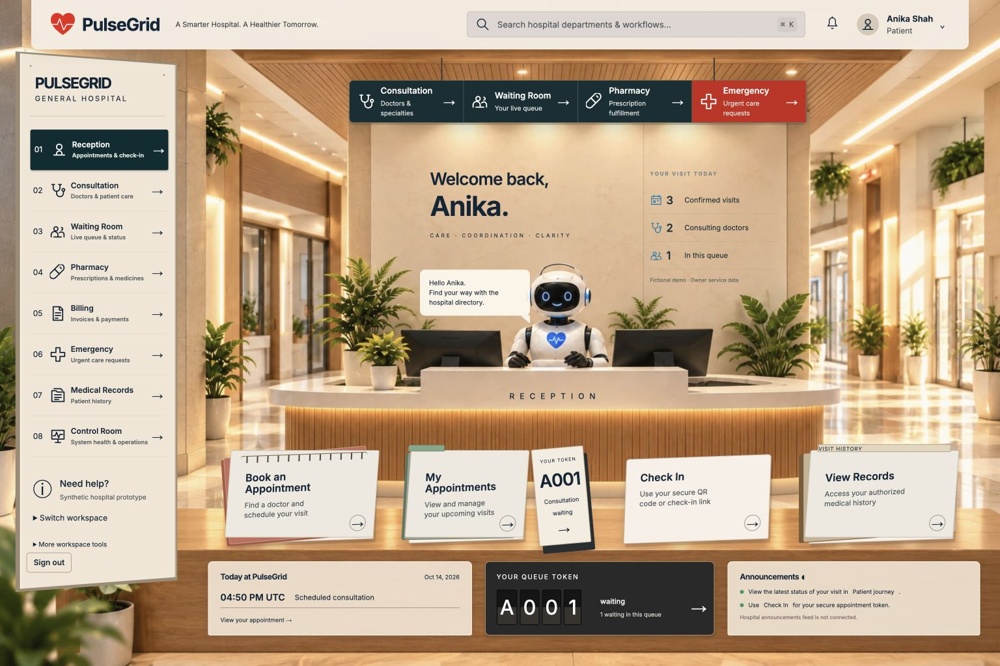
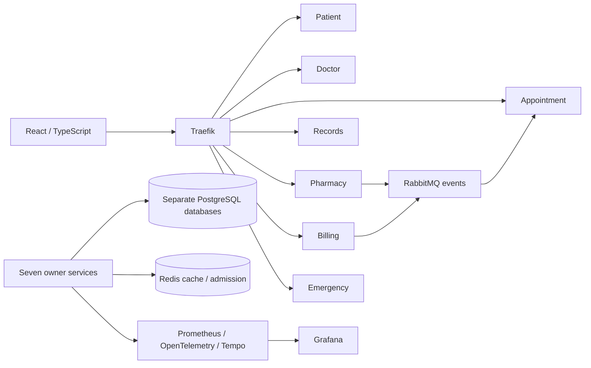

# PulseGrid

**A hospital workflow prototype built around seven independent services.**

PulseGrid is a synthetic, single-hospital educational project for the System Design Laboratory. It combines patient and staff workflows with transactional data ownership, asynchronous reconciliation, resilience controls and distributed observability. The React interface uses warm hospital interiors, physical directory navigation and department-specific workspaces.



> Educational prototype only. All records are synthetic. Payments and insurance estimates are simulated. This project does not claim clinical certification, reliable emergency dispatch or production availability.

## What it does

| Domain | Workflows |
| --- | --- |
| Patient | Registration, authentication, sessions, profiles and role authority |
| Doctor | Discovery, profiles and schedule proposals |
| Appointment | Accepted schedules, booking, cancellation/rescheduling, waitlists, check-in, consultation queues and patient journeys |
| Records | Clinical records, notes, prescriptions and scoped access |
| Pharmacy | Medicine catalog, inventory, reservations, fulfillment and dispensing |
| Billing | Invoices, owner charge imports, simulated payments and insurance estimates |
| Emergency | Patient requests and authorized staff priority, claim and status workflows |

Patient and staff workspaces expose actions according to actual permissions. The Control Room monitors software services, telemetry and manual Surge Mode; it does not implement bed or staff management.

## Architecture



- **Backend:** Python/FastAPI, seven independent domains with separate databases, migrations and credentials.
- **Frontend:** React 19, TypeScript, Vite, Motion and GSAP.
- **Infrastructure:** Docker Compose, PostgreSQL, Redis, RabbitMQ and Traefik.
- **Observability:** Prometheus, Grafana, OpenTelemetry and Tempo.
- **Verification:** pytest/PostgreSQL integration checks, Vitest, browser evidence and Locust experiments.

PostgreSQL transactions, locks and constraints enforce business correctness. Redis is not booking authority. Outbox/inbox delivery is at least once; events wake reconciliation, which reads authoritative owner APIs. Cross-service workflows use bounded authenticated calls and explicit degraded states. No shared database queries or global transaction claims.

## Current status

Phases 1–8 have implementation and verification reports with their scoped limitations. Phase 8.2 completed its documented local Doctor scalability matrix; those measurements are not production capacity estimates.

Phase 9 redesigned the hospital workspaces and retained the approved Reception and Consultation compositions. The latest visual correction checkpoint is **PARTIAL**: shared directory and Waiting Room corrections are complete within documented limits; Pharmacy cabinet/counter positioning and additional role/responsive browser checks remain. Physical QR camera decoding is unverified in the tested environment.

Latest checkpoint validation: **142 frontend tests passed**, TypeScript passed and production build passed. These are recorded checks, not a claim that every backend scenario was rerun at that checkpoint.

- [Phase 9 continuation and workflow evidence](docs/phase-9-resume.md)
- [Latest visual corrections and exact resume point](docs/phase-9-visual-fidelity-corrections.md)
- [Frontend design system](docs/phase-9-design-system.md)
- [Phase 8.2 measured scalability evaluation](docs/phase-8-2-scalability-finalization.md)

## Run locally

### Prerequisites

Docker with Compose v2, Python compatible with the service packages, and Node.js/npm compatible with the frontend lockfile. Run commands from the repository root. The backend must be running for sign-in and hospital workflows; starting Vite alone is insufficient.

### First-time backend setup

```sh
python3 infra/scripts/init-env.py
python3 -m venv .venv
. .venv/bin/activate
python -m pip install -e 'services/patient[test]'
python services/patient/generate_auth_keys.py --directory secrets/auth
```

Add the development settings from [auth.env.example](services/patient/auth.env.example) to the generated, ignored root `.env`. Keep generated passwords. Never overwrite retained credentials or regenerate existing signing keys.

```sh
python3 infra/scripts/configure-rabbitmq-events.py
python3 infra/phase4/init_config.py

docker compose -f compose.yaml -f services/patient/compose.auth.yaml -f compose.phase4.yaml config --quiet

# Build domains separately when Docker has limited memory.
for domain in patient doctor appointment records pharmacy billing emergency; do
  docker compose -f compose.yaml -f services/patient/compose.auth.yaml -f compose.phase4.yaml build "$domain" || exit 1
done

docker compose -f compose.yaml -f services/patient/compose.auth.yaml -f compose.phase4.yaml up -d --no-build
```

Migration jobs must exit successfully before their APIs start. The gateway is at `http://127.0.0.1:8080`; Patient readiness is `/api/v1/patients/health/ready`. Optional observability uses `compose.observability.yaml`; follow the [observability runbook](docs/phase-7-observability-design.md) for its configuration.

### Start an existing installation

Reuse its `.env`, signing keys and volumes:

```sh
docker compose -f compose.yaml -f services/patient/compose.auth.yaml -f compose.phase4.yaml up -d --no-build
```

Use the same overlays originally configured for that installation. Do not reset volumes to fix a login problem; inspect service health and configuration first.

### Frontend

In another terminal:

```sh
cd frontend
npm ci
npm run dev -- --host 127.0.0.1 --strictPort
```

Open **http://127.0.0.1:5173**. Vite proxies API requests to the loopback gateway. Register a synthetic patient through the application. Privileged roles require the documented authorized bootstrap; there is no universal staff password. Local demo credentials, mappings and signing keys are deliberately excluded from Git.

See [infrastructure](docs/infrastructure.md) and [authentication integration](docs/authentication-integration.md) for configuration, bootstrap, migrations and troubleshooting. Production frontend builds need an API reverse proxy; the static build does not start backend services.

#### UI development without the backend

`npm run dev:mock` (from `frontend/`) starts Vite with a dev-only fixture API that answers `/api/*` in memory instead of proxying to the gateway. Sign in with any password; the email picks the role: `patient@`, `doctor@`, `receptionist@`, `pharmacist@`, `billing@`, `emergency@`, `admin@` or `ops@mock.test`. Every page shows a MOCK DATA ribbon. The fixtures in `frontend/dev-mock/` are synthetic, are served only by the dev server and are excluded from `npm run build`. Mock mode is for layout work; it does not verify real API behaviour. `npm run build:demo` produces a separate static demo (used for the Vercel preview, configured in `frontend/vercel.json`) that runs the same fixtures in the browser; the normal `npm run build` never includes them.

## Validation

```sh
npm --prefix frontend run typecheck
npm --prefix frontend test
npm --prefix frontend run build
```

Backend tests live in each service. [The regression runner](tests/run_phase2_regressions.py) requires installed test extras and local PostgreSQL tooling, and uses disposable test databases. Live workflow verifiers have specific synthetic-fixture prerequisites and may perform mutations or bounded outages; read their verification documents before running them against a retained stack.

## Repository map

```text
services/       Seven FastAPI domains, migrations and colocated tests
frontend/       React application, API clients, assets and UI tests
infra/          Gateway, databases, credentials bootstrap and telemetry config
experiments/    Load experiments and recorded synthetic measurements
tests/          Cross-service, authentication and infrastructure verification
docs/           Architecture, contracts, runbooks and browser evidence
compose*.yaml   Local deployment and optional overlays
```

## Documentation

- [Architecture](docs/architecture.md) · [Service boundaries](docs/service-boundaries.md) · [Database design](docs/database-design.md)
- [Security](docs/security.md) · [Roadmap](docs/development-roadmap.md)
- [Phase 2 contracts](docs/phase-2-api-contracts.md) · [Verification](docs/phase-2-integration-verification.md)
- [Phase 3 contracts](docs/phase-3-api-contracts.md) · [Verification](docs/phase-3-integration-verification.md)
- [Phase 4 component contracts](docs/phase-4-component-contracts.md) · [Verification](docs/phase-4-integration-verification.md)
- [Phase 5 event contracts](docs/phase-5-event-contracts.md) · [Verification](docs/phase-5-integration-verification.md)
- [Phase 6 resilience](docs/phase-6-resilience-design.md) · [Verification](docs/phase-6-integration-verification.md)
- [Phase 7 observability](docs/phase-7-observability-design.md) · [Verification](docs/phase-7-integration-verification.md)

Older foundation documents include proposed architecture. Phase-specific contracts and verification reports distinguish implemented behavior, measured results and remaining work. The repository contains source, synthetic evidence and development history; private local credentials and runtime data stay excluded.
