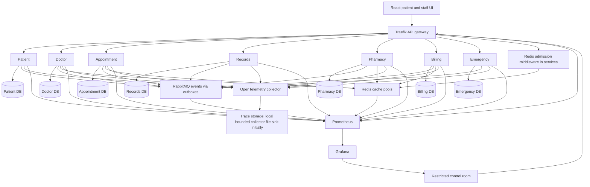
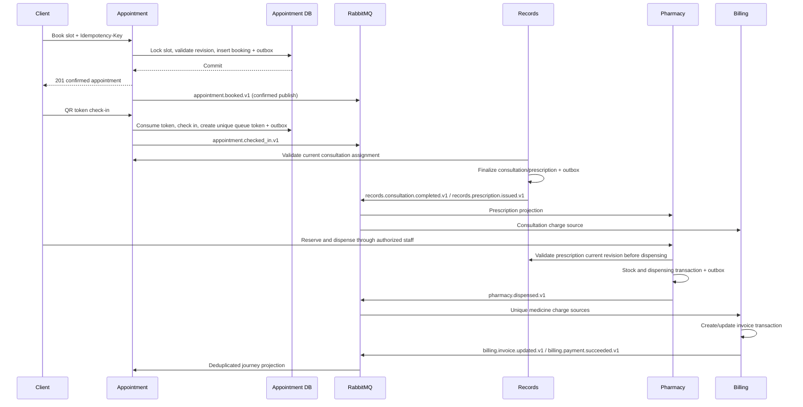

# Architecture

## Scope and decisions

PulseGrid serves one synthetic hospital. It includes patient and staff workflows, emergency request tracking, and a restricted distributed systems control room. Multi-hospital networking, emergency bed management, family health profiles, predictive autoscaling, and forecasting are excluded. Phase 1.1 defined this architecture. Phase 1.4B implements the local database, migration and gateway foundation described in [infrastructure.md](infrastructure.md); hospital workflows and algorithm components remain proposed.

The stack is React/TypeScript, Python/FastAPI, PostgreSQL, Redis, RabbitMQ, Traefik, Docker Compose, Locust, Prometheus/Grafana, and OpenTelemetry. Avoid Kubernetes and additional infrastructure unless a later requirement justifies it through an architecture decision documented here.

Seven domain services are independently packaged and deployable. One prototype PostgreSQL instance hosts seven logical databases with separate credentials. Redis, RabbitMQ, routing, and telemetry are shared infrastructure, never domain ownership authorities. Stateless API replicas share only their own persistent database and explicit infrastructure. No service imports another service's ORM or queries its database. External references are IDs with validated local snapshots, never cross-database foreign keys.

Arrows to RabbitMQ represent publishers and subscriptions, expanded below. Traefik routes; admission middleware executes in each service before business logic, using the distributed rate limiter. All business routes pass admission, including internal calls with separate trusted budgets. Compose services and the displayed middleware are not an eighth domain service. Grafana/trace access is through restricted infrastructure routes, not direct public telemetry endpoints. Initial file-backed tracing is a bounded development artifact, not a production query backend; a later observability decision must select a simple trace query backend for control-room trace search (see roadmap Phase 8).

## Authorities and critical consistency boundaries

| Boundary | Authority and guarantee | Replicas and stale reads |
|---|---|---|
| Identity, credentials, roles, refresh revocation | Patient DB transactions; token claims bounded by expiry | Local JWT verification; privileged mutations check current authorization |
| Approved schedule and active bookings | Appointment DB active slot revision, row locks, unique active booking per slot | Availability caches can lag; booking revalidates locally in transaction |
| Medical records and final prescriptions | Records DB transactions, revisions and access checks | Pharmacy receives a validated prescription projection by event |
| Inventory and reservations | Pharmacy DB conditional stock updates and reservation state | Search caches never authorize reservation/dispensing |
| Invoice state and simulated payment | Billing DB locking, unique payment idempotency and source charges | Estimate projections are eventual, not final invoice authority |
| Emergency priority/claim state | Emergency DB atomic claim and version checks | Tracking projections can lag; emergency capacity is separate |
| Sensitive audit history | Per-service database ordered hash chain in the mutation transaction | Independent chains; no global total order is claimed |

Strong consistency is local to each row/aggregate and its service database. Eventual consistency applies to discovery caches, schedule acknowledgement views, journey timeline, prescription delivery, insurance estimates, invoice generation, metrics, and notifications. No request claims completion for another service before that service has committed it.

## Synchronous communication

Browser -> Traefik -> owning service is the default. Services validate JWT audience/issuer, RBAC, resource ownership, and admission budgets themselves; gateway checks are insufficient.

- Doctor profile and policy discovery: Doctor API; operational availability: Appointment API.
- Records checks Appointment consultation assignment before a clinician finalizes a consultation/prescription. Pharmacy checks Records' current prescription revision and revocation before dispensing. Fail closed if unavailable; a prior cached result cannot authorize these writes.
- Privileged writes use Patient's internal authorization check for current account/role status. Patient is consequently a dependency for sensitive operations. Nonprivileged patient reads use short-lived claims and resource ownership checks.
- Cross-service reference validation occurs before opening local transactions. Versioned response snapshots and conditional writes prevent local stale updates. Remote validation cannot create a global transaction; revocation races require compensation/review as described in security.
- Aggregated journey reads come from Appointment's event projection with `observed_at` and per-stage pending state. UI may separately retrieve Records, Pharmacy, and Billing resources with their own permissions.

Initial configurable targets: external request deadline 3 s; downstream call timeout 1 s; maximum two attempts including the first, within the parent deadline, with exponential backoff and jitter. Retry safe reads and writes only with a persisted idempotency key. Never retry validation errors or blindly retry POST. Circuit opens after five consecutive connection/time-out failures, waits 15 s, then admits a bounded half-open probe. These are experiment starting points, not measured tuning results. Pass remaining deadlines to downstream calls; no network calls inside database lock scopes.

## Asynchronous communication and schedule handoff

RabbitMQ durable topic exchange `pulsegrid.events` routes event names to one durable queue per logical consumer, with multiple competing worker replicas. Publishers use transactional outboxes and publisher confirms. Consumers use inbox deduplication and local transactions. Delivery is at least once; business effects must be effectively once. There is no globally ordered delivery.

Doctor owns schedule intentions, timezone, specialty, appointment length, and profile. Appointment owns accepted bookable slot revisions and local copies of scheduling rules needed for correctness. Doctor submits a new immutable schedule version in `doctor.schedule.proposed.v1`. Appointment serializes processing per doctor, reconciles affected slots and active bookings, and publishes `appointment.schedule.accepted.v1` or `appointment.schedule.rejected.v1`. Doctor activates its display version on acknowledgement. Proposal is pending until then. Appointment processes proposal revisions in order, including rejected revisions; `previous_revision` names the previous proposal, not the last accepted schedule. Gaps trigger replay/reconciliation. Doctor tracks both last decided proposal revision and last accepted operational revision. Changes overlapping active bookings are rejected with conflict IDs; an authorized explicit reschedule/cancellation must resolve conflicts first. Appointment's committed accepted version controls availability even if acknowledgement delivery is delayed. New bookings never depend on querying Doctor during their transaction.

The consultation is not blocked by billing or insurance estimates. Appointment receives consultation completion to advance its queue and journey. The event catalog defines each subscription, including asynchronous projection events omitted from the diagram.

## Booking, waitlists, queues, and journey

A slot represents one doctor and one fixed non-overlapping interval, with capacity one in the initial model. Appointment materializes slots from accepted schedule versions. Unique active booking and interval overlap constraints backstop row locks. Cancelled or completed historical slots cannot be booked after their booking cutoff; completion does not make a past interval discoverable again. Cancellation and promotion occur in one transaction under the slot lock: release booking, choose oldest eligible waiting entry by `(joined_at, id)`, create confirmed booking, update waitlist, append outbox events. Once waiting entries exist, new arrivals join behind them; they cannot take a released slot between cancellation and promotion. Promotion creates a confirmed appointment, visible to the patient without relying on notifications. Eligibility uses validated local patient-active snapshots; stale deactivation is reconciled and can cancel an ineligible promotion. This is not a globally instantaneous account check.

Rescheduling locks source and target slots in sorted ID order, validates the target and waitlist fairness, moves the booking, and promotes the source waitlist atomically. On conflict everything rolls back; the source appointment survives. One patient cannot hold overlapping active appointment intervals. Check-in consumes a one-use short-link token and verifies patient, appointment, state, and configurable check-in window atomically. Queue tokens have unique doctor/day sequence numbers; display positions are recomputed from state and are not permanent numbers. Consultation start is an Appointment command; a clinician may hold only one in-progress consultation at a time.

Appointment's journey projection follows registration -> appointment -> check-in -> consultation -> prescription -> pharmacy -> billing -> discharge. Registration starts the profile; the episode/journey starts with booking. Each booking has its own `journey_id`, retained on rescheduling. Pharmacy is optional when there is no prescription. Discharge is a local Appointment command gated on committed completion projections for required stages and zero invoice balance, with the invoice projection acknowledging every expected consultation/dispensing charge source ID. A paid invoice missing a delayed pharmacy charge is not discharge-ready. Missing/out-of-order events leave pending stages; version gaps are reconciled. A later prescription revocation, clinical amendment, invoice adjustment, or payment reversal can reopen the relevant stage and require a new discharge decision. Never infer medical discharge suitability: this is a simulated workflow completion.

## Integrated system-design components

| Component | Workflow and planned owner | Correctness/failure behavior | Evaluation |
|---|---|---|---|
| Token bucket | Common service admission middleware; Redis atomic script; Emergency separate capacity | Atomic tokens across replicas; Redis outage uses conservative local budgets, never unbounded fail-open | Allowed/denied totals, fairness, latency, surge vs baseline |
| Consistent hashing + virtual nodes | Doctor/Pharmacy cache clients place search/profile keys across optional Redis cache nodes | Separate cache pool from dedicated rate-limit Redis; versioned ring changes use cache miss/refill or dual read during bounded transition | Remapping fraction, balance, hit rate for add/remove |
| Key-value store | Redis cache-aside in Doctor/Pharmacy, optional availability and estimate caches | DB authoritative; outbox invalidation + TTL + monotonic versions; stale misses rehydrate | Hit/miss p50/p95 and DB load vs no cache |
| Snowflake IDs | Independently owned service modules with identical reviewed algorithm contract | 41-bit time + 10-bit worker + 12-bit sequence, 63-bit nonnegative; explicit worker allocation and rollback refusal | Collisions, rollover, restarts, rollback and IDs/s |
| URL shortener | Appointment `/s/{token}` resolves opaque appointment/check-in links | Random 128-bit token encoded Base62, hashed at rest, expiring, revocable; authenticated redemption | Collisions, expiry, replay rejection, resolution latency |
| Web crawler | Billing-owned worker extracts insurance fixtures via isolated synthetic provider HTTP sites | Allowlisted hosts, bounded extraction; versioned provenance; estimates can be stale | Accuracy against fixture truth, timeout and freshness |
| Trie/radix trie autocomplete | Doctor doctor/specialty lookup; Pharmacy medicine lookup; per-replica read snapshots | Updated from owning DB versions; periodically reconcile; errors fall back to indexed prefix query | Memory, build time and prefix p95 vs PostgreSQL baseline |

Snowflake epoch is planned as `2026-01-01T00:00:00Z`. Assign worker ID `(service_code << 7) | replica_code`, service codes Patient=0, Doctor=1, Appointment=2, Records=3, Pharmacy=4, Billing=5, Emergency=6; replicas 0..127. Infra assigns unique active replica codes. Persist a per-worker high-watermark in the owning DB and acquire an exclusive DB advisory lock for worker lifetime on a dedicated connection. Stop generating on lock loss, clock rollback, or DB uncertainty; reserve timestamp ranges durably before emitting IDs so restart cannot repeat issued ranges. Sequence exhaustion waits for the next eligible millisecond. Formalize and test range reservation in the ID phase before use. IDs are JSON strings to avoid JavaScript precision loss, never authorization secrets. A shared standards contract is permitted; a shared runtime service or ORM is not required.

## Surge mode, fault isolation, and observability

Admission budgets are partitioned by domain and role, with a protected Emergency request budget and reserved Emergency worker concurrency. Enforce per-principal plus global service quotas. Unknown/unauthenticated emergency submissions use a limited public quota; authenticated submissions have a separate budget. Redis-backed decisions are authoritative for shared quotas only while Redis is reachable; conservative local fallback limits total traffic approximately, with configured replica-count bounds. No claims of exact distributed limits during cache failure.

Emergency scheduling uses severity as assigned by authorized staff, then aging and FIFO within equal priority; user-entered urgency is not trusted clinical triage. Reserve worker opportunities for older lower-priority requests after a configurable maximum wait and measure starvation. Surge policies can defer crawler refresh and costly noncritical search; writes report explicit rejection or persisted `pending`, never silently drop accepted work. Frontend polls queues with bounded backoff initially; real-time push is a later choice, not a new infrastructure dependency.

Health: `/health/live` only process liveness; `/health/ready` DB and required synchronous dependencies. Broker/Redis outage reports degradation, but does not remove all replicas capable of accepting durable local writes. Readiness must reject new work when outbox backlog exceeds configured storage/age thresholds. Drain traffic, finish bounded in-flight transactions, stop worker claims, flush telemetry within a deadline, then exit on SIGTERM. Circuit breakers isolate optional dependencies; dependency failures return documented 503/504 or pending state.

Emit W3C trace context, request/correlation IDs, latency histograms, error counts, inflight requests, pool saturation, admission outcomes, cache ring/version/hits, outbox age, inbox duplicates, broker backlog/DLQ, emergency wait time and resource usage. Never use patient IDs, tokens, or record contents as metric labels. OpenTelemetry context continues over events. Telemetry failure must not fail business operations. Control room access is hospital_admin/ops with read-only operational aggregates; admin alone has no general medical-record access.

Chaos experiments run only against synthetic isolated deployments with an explicit target, stop condition, baseline, expected degraded behavior, and recovery verification. Terminate replicas, disable cache/broker, and inject network delay; do not confuse a chaos injection with clinical resiliency proof. Locust seeds, scenarios, topology, run duration, warmup, resource limits, commit, percentiles, error definitions and repeated trials must be recorded.

## Distributed transaction trade-offs and deployment limitations

No two-phase commit. Every domain mutation plus its outbox/audit entry is one local transaction. Downstream actions are pending until applied, may retry, and may require compensating business commands. Examples: revoked prescription releases unfilled reservations; already-dispensed items trigger staff review; cancelled consultation charges create an explicit invoice adjustment rather than deleting history. Services retain authoritative state and provide internal reconciliation APIs for events missed past retention.

Potential prototype single points of failure: PostgreSQL instance (all seven databases), RabbitMQ instance, dedicated Redis admission node, gateway instance, Compose host/network/disk, and telemetry storage. Cache nodes can disappear without losing domain correctness; rate limits degrade. PostgreSQL outage blocks authoritative writes; RabbitMQ outage delays projections until outboxes replay. Shared instance CPU/I/O and connection limits cause correlated failures despite logical ownership. Configure per-service connection budgets and resource limits. Multiple API replicas alone do not provide infrastructure high availability. Backups/restore, broker replication and separate database hosts are later experiments; the prototype makes no HA claim for them.

Compared with a monolith this design adds network latency, duplicate snapshots, seven migration streams, schema/event compatibility management, outbox/inbox storage, authorization hops, tracing and more operational failure modes. These costs are intentional educational scope. Keep the frontend a single application and use simple local transactions; split only the seven required domains. Infrastructure shared libraries must be narrow and versioned; avoid coupling domain releases through a universal shared model.
