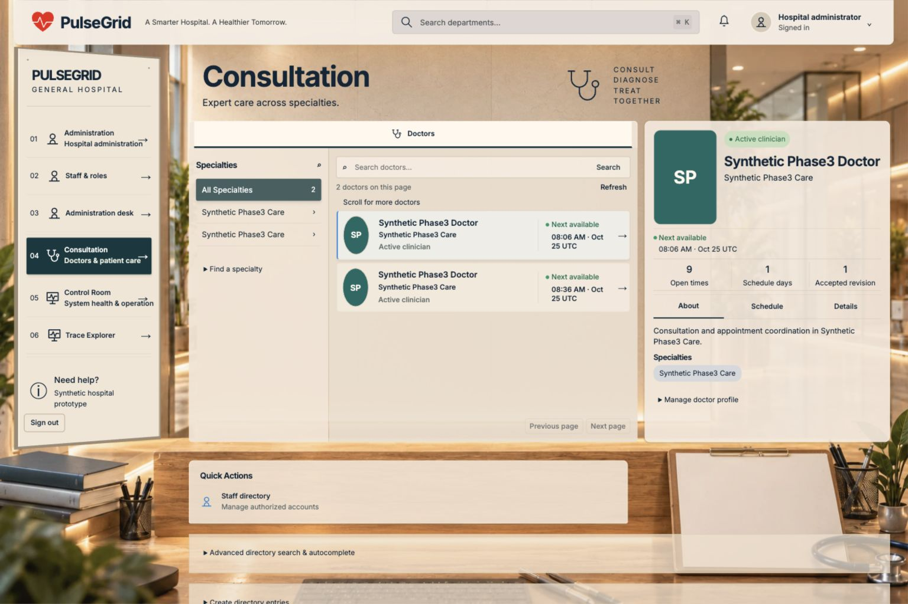

# Actual browser and visual QA

Real isolated backend mode (`VITE_MOCK_API=false`, `VITE_DEMO_MOCK=false`, `VITE_LOCAL_HOSPITAL_DEMO=false`) at 19173 → 18880. Browser evidence is separate from frontend mock tests and historical static-demo screenshots. [Recorded routes/actions](evidence/browser/browser-checks.json).

All **35 workspace routes across eight roles were visited**: patient 12, Doctor 4, reception 2, Pharmacy 3, Billing 4, Emergency 2, admin 6, ops 2; public register/login/logout were exercised. Most staff writes were verified through API/DB rather than repeated through every browser form. Route visits are not every-control acceptance.

## Actual interactions and responsive scope

- New fictional patient registration, real login/session navigation and sign-out; Emergency review/send with owner request appearing in Your requests.
- Populated patient/doctor/staff/operator screens; Doctor profile About/Schedule/Details; accepted-slot selection, review/confirm booking, backend confirmation slip, persisted My Appointments/detail, review/confirm cancellation with Cancelled owner state.
- Department search filters to authorized Billing result and navigates. Notifications explicitly explain the absent feed and point to owner-confirmed status views, rather than invent notifications.
- Mobile navigation declares a modal dialog, focuses Reception, Shift+Tab wraps to Sign out, and Escape dismisses/returns focus to Open navigation menu.
- Eight primary patient screens and Control Room sampled at 1536×1024, 1440×900, 1280×800 and 390×844. Recorded settled samples showed no document horizontal overflow. Initial chained-load/timeouts were rechecked where stated; not every saved early screenshot is a settled-state PASS.
- Billing payment-history and insurance panels were reopened after loading: real succeeded payment and rule/source provenance displayed. Staff/Doctor routes had separate desktop rechecks.
- Final captured console warning/error log was empty. No dedicated network recording/HAR was captured, so an empty console is not proof of zero network failures. Actual API failures are retained in the baseline report.

## Repaired visual defects

B-04: high-specificity scene selectors hid three of six admin directory links. Removed obsolete hide/focus-only reveal rules; all six are visible without focus. B-05: selected subtitles had dark foreground on dark teal after a late readability override. Final scoped color restores readable light text. The existing department compositions, images and layout system were preserved.

[Before/after computed styles](evidence/browser/directory-before-after.json), [before image](evidence/browser/admin-directory-before-1536.jpg), [after image](evidence/browser/admin-directory-after-1536.jpg).

Other useful actual-browser evidence: [booking confirmation](evidence/browser/patient-browser-booking-confirmed-1536.jpg), [cancellation](evidence/browser/patient-browser-cancellation-1536.jpg), [Emergency request](evidence/browser/patient-emergency-submitted-1536.jpg), [settled mobile Billing](evidence/browser/patient-billing-settled-390.jpg).

159 frontend tests and normal TypeScript/production build pass after the CSS corrections. Current tests cover cleanup/reduced-motion and shared interaction contracts; this report does not claim fresh manual acceptance of every animation/preference combination.

## Acceptance still incomplete

Every button/form/filter/modal/drawer/error state was not exercised for every role and viewport. Four-size coverage does not extend to every staff secondary screen. Physical QR camera decoding remains unverified; server token generation, ownership, expiry/replay and actual check-in were executed separately. No claim of pixel-perfect comparison to every historical reference, optical scanner PASS, complete accessibility certification, or user design sign-off is made. Browser viewport override was reset after testing.
