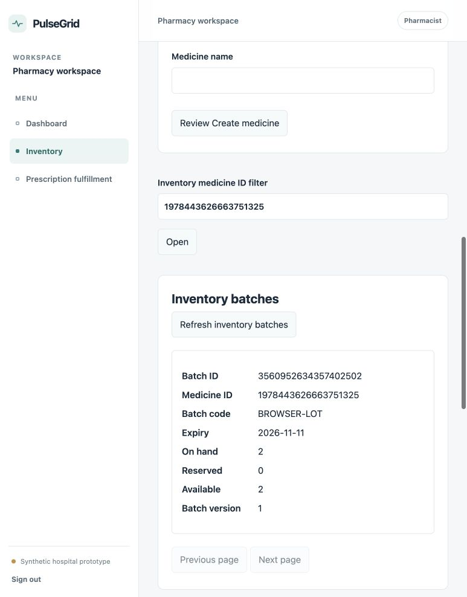
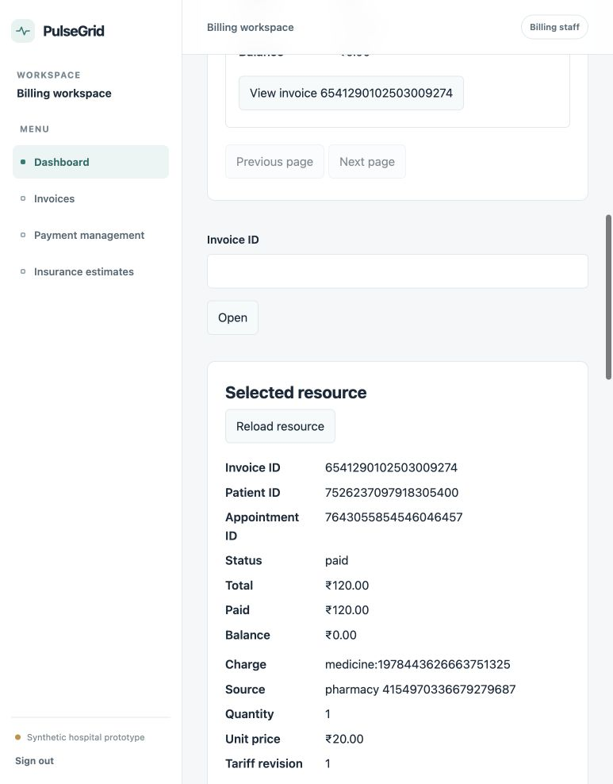

# Phase 2.9 integration and verification

Integration record, 2026-10-11. Synthetic single-hospital prototype. Common base `de63867adb7f5863c708ee19f4376ccbb49a0691`. This report records executed checks; incomplete checkpoints are not completion claims.

## Checkpoint A: integration complete

Initial main was clean at the common base. All eight source commits existed locally, descended from that base and changed only their assigned service/frontend prefixes. Reviewed route/dependency/migration changes and parsed Python syntax before applying. Every cherry-pick completed without conflict, expected files were present and status was clean after each. Original branches and worktrees were neither modified nor deleted.

| Domain | Original SHA | Cherry-picked main SHA |
|---|---|---|
| Patient | 280b4e3bdb7d39faf2fb9137cb61da0543f3305d | 71bb99710f6eddc9f34c412524c3d8a3023829dc |
| Doctor | a09b16d4e5bb70c15ea6f095e580cf9dc3ad0e56 | d678f0fc8a43fba4fe9a42f35fac5c1639aa7c78 |
| Appointment | 60161d12ae2263ab19e855c81fa43cd522f3d5fc | fed08f6763d85dfaac737fecaf67bdfcb748713a |
| Records | a1fca50144103e7019a30eabe0d3befa8d0a79f6 | 225efbf28baec73eab29c7576b57d7844d872998 |
| Pharmacy | a6931a100e3dbbdddb147e5cb115b3c3d622c00d | 081410a114d0cc8107e1ed6eb040a22b61e6596b |
| Billing | 7f490f9d688248fd1e057082d2332ddfa53cd3f9 | fdc1b6fd6560df5c2f96646cd311b6e97c649d84 |
| Emergency | 8917af46c09f599bae6ca2ba3b86be5e24d2e09e | 344f163ef490484947b6948c3117d259c66cce6a |
| Frontend | e700170d9dd62501a5244f6fd738e4e004bf1d8b | 48a8fe1fee4178d4df7d04c268515d03c9d1b483 |

## Checkpoints and completion scope

| Checkpoint | Executed result |
|---|---|
| A: eight commits integrated | PASS, ordered cherry-picks without conflicts; original worktrees and branches retained |
| B: migrations | PASS, all seven owned migration jobs exit 0, one head per service, persistent volumes retained |
| C: service startup and communication | PASS, seven healthy APIs; private authenticated owner calls exercised by real HTTP workflows |
| D: backend/frontend regressions | PASS, 453 distinct backend tests and 85 frontend tests; frontend typecheck/build pass |
| E: hospital workflows | PASS, 11 real Traefik workflow groups, exclusive booking competition, ownership/RBAC and explicit revocation recovery |
| F: browser verification | PASS, required patient flows plus real Doctor, Pharmacy and Billing form transactions; final logout redirects protected routes |

Completion means the user-defined Phase 2 hospital workflows and REST interim contracts. It does not include the broader future system-design algorithms, automatic event convergence, clinical certification or infrastructure HA. The requested Phase 2 integration is complete; checkpoints A–F passed. No critical broken Phase 2 workflow is currently identified. Browser checks are not an exhaustive test of every form, viewport or failure scenario.

## Database migrations and preservation

| Service | Applied head | Live owned tables | Frozen method/path entries present |
|---|---|---:|---:|
| Patient | `0004_patient_management_audit` | 10 | 18 |
| Doctor | `0004_doctor_management` | 12 | 13 |
| Appointment | `0003_booking` | 18 | 14 |
| Records | `0004_clinical_integrity` | 12 | 15 |
| Pharmacy | `0003_phase2_pharmacy` | 15 | 16 |
| Billing | `0003_billing_phase2` | 16 | 8 |
| Emergency | `0003_emergency_workflow` | 8 | 7 |

Migrations ran via the existing root Compose plus Patient authentication overlay. Each service retains its original Phase 1 revision chain; there are no duplicate heads within a service. Similar numeric revision prefixes in different owned databases are independent. No applied migration was rewritten, no database reset/downgrade was run, and no persistent volume was removed. All seven images were rebuilt sequentially before startup.

Before migration, Patient contained 17 users, 29 refresh sessions and 84 audit entries. Aggregate hashes of account identity/password hashes, session token hashes/revocation state and audit chain entries matched exactly immediately after migration. Later tests add synthetic identities and immutable audit history, so those original row counts are not expected to remain the final counts. The existing Patient bootstrap function was used explicitly to promote a registered synthetic first administrator; public registration still cannot assign staff roles.

Live checks verified metadata tables, columns, nullability, primary keys, check-constraint counts, unique keys and exclusion constraints, declared indexes and local-FK semantics/ownership, runtime non-superuser/non-DDL permissions, denied direct audit mutation, actual Appointment GiST exclusions, and Alembic head alignment. All 42 attempted runtime connections to another domain database failed specifically for database permission denial. Catalog inspection confirmed all 14 runtime/migration roles lack foreign CONNECT. Audit sequences, previous hashes, final heads and entry digests pass for all seven domains; Pharmacy uses its owned compact sorted JSON encoding while other domain functions hash PostgreSQL JSONB text. Outbox rows exist in each database and remain unpublished. Disposable PostgreSQL tests verify rollback, local transaction effects, audit permissions and idempotency without truncating persistent Compose data.

## Actual interfaces and dependencies

The [Phase 2 API freeze](phase-2-api-contracts.md) remains the detailed method/schema/access reference. Live service OpenAPI contains all 91 distinct frozen method/path entries, including private leaves. This is endpoint presence verification, not a claim of full schema equivalence from path checks alone. Service contract tests, real dependency-client validation, HTTP response assertions and browser consumers provide additional compatibility evidence.

| Public API group | Working behavior exercised |
|---|---|
| `/api/v1/auth/*`, `/api/v1/patients/me` | Registration, login, CSRF, refresh rotation/replay/logout, profile read/update |
| `/api/v1/patients/users/*` | Admin staff-role assignment for synthetic fixtures; account/last-admin rules covered by PostgreSQL tests |
| `/api/v1/doctors/*` | Specialties, doctor/staff mapping, profiles, proposal creation and explicit reconciliation |
| `/api/v1/appointments/*` | Accepted schedule decisions/availability, book/list/detail/cancel/reschedule, private contexts and clinical holds |
| `/api/v1/records/*` | Assigned consultations, finalization, immutable records, prescriptions, history and revocation |
| `/api/v1/pharmacy/*` | Medicine catalog, stock adjustments, reservations, dispense, revalidation, inventory and completed charge contexts |
| `/api/v1/billing/*` | Tariffs, invoice creation, explicit charge import/deduplication, payment decline/success and balances |
| `/api/v1/emergencies/*` | Patient submission, staff priority/claim, processing/resolution and tracking |

| Initiating service -> owner | Actual Phase 2 interaction | Consistency/recovery |
|---|---|---|
| Every privileged writer -> Patient | Existing signed `authorization:check`; current role/account authority | Fail closed, preserved Phase 1 timeout 503; no public actor headers |
| Doctor -> Patient | Private staff-status validates doctor account/role | Owner authority, no Doctor-created identity database |
| Appointment -> Patient/Doctor | Patient status; Doctor identity and immutable proposal snapshots | Validate before local transaction; accepted slots/bookings belong to Appointment |
| Doctor -> Appointment | Decision reconciliation and operational-status before closure/deactivation | Separate explicit operations, no automatic broker acknowledgment |
| Records -> Appointment/Patient/Pharmacy | Assigned consultation context and durable hold; patient status; medicine validation | Remote calls outside DB transactions/locks; persisted preparation and same-command recovery |
| Pharmacy -> Records | Live prescription dispensing context before reserve/dispense/revalidate | Local allowances/stock atomic; explicit release/revalidation after revocation |
| Billing -> Appointment/Records/Pharmacy | Invoice patient context, finalized consultation and completed dispensing charge sources | Unique source imports plus local invoice/payment transaction; incomplete charge coverage is explicit |
| Emergency -> Patient | Active patient reference and privileged staff authority | Local request/claim/transition transaction; patient urgency is advisory |
| Frontend -> public owner APIs | In-memory access token, retained cookie/CSRF session flow, ETags and command keys | Server scope remains authoritative; no automatic clinical/billing orchestration |

Private tokens use the existing RS256 service issuer/audience/scope binding plus delegated user bearer token. Owner context/catalog/status endpoints are leaves reading only their own database, so bidirectional service names do not form recursive synchronous call chains. No shared ORM entities, foreign database reads, cross-database joins, undocumented broker worker or new service dependency was added.

## Executed hospital and concurrency workflows

`tests/verify_phase2.py` exercised real HTTP through Traefik with synthetic patient, second patient, assigned and unassigned doctor, pharmacist, billing and emergency staff accounts:

1. Registered/authenticated identities, configured staff through authorized Patient administration, read/updated the patient's profile.
2. Created specialty/doctor mapping, proposed eight future slots, accepted through Appointment, reconciled Doctor and retrieved accepted availability.
3. Booked, rescheduled and cancelled appointments; another patient's appointment read returned 404.
4. Two distinct patients competed for one slot through the real gateway: exactly one 201 and one 409. Confirmed booking state remained exclusive.
5. Assigned doctor created/finalized a consultation and prescription using live private contexts/holds. An unassigned doctor was rejected. Patient history/document reads succeeded; another patient's record/prescription reads returned 404. Clinical work prevented cancellation with 409.
6. Added 10 units of stock, reserved/dispensed two, retried dispensing without another deduction: on_hand 8, reserved 0. Another patient could not read the reservation.
7. Configured consultation tariff 10000 INR minor units and medicine tariff 2500 per unit. Imported one consultation plus two medicines: exactly two source items, total 15000. Reimport did not duplicate charges. Simulated decline left paid 0; success produced paid 15000 and balance 0. Another patient's invoice read returned 404.
8. Patient submitted emergency request but could not assign priority (403). Staff assigned priority, claimed, progressed to processing and resolved the request.
9. Revocation rejected a new reservation. For a second unfilled prescription, revoked dispensing returned 409; revalidation released its reserved quantity, a second revalidation did not release again, stock remained on_hand 8/reserved 0.
10. All seven protected domain entry points rejected unauthenticated requests with 401.

The harness reports 11 named groups because several related assertions are grouped separately. Its private `/tmp/pulsegrid-phase29-live-fixture.json` retains generated passwords and resource IDs for resume/browser verification, mode 0600. It is not committed or printed. The first run requires an explicitly authorized first-admin bootstrap and the existing auth-test localhost PostgreSQL overlay; later runs reuse the fixture. It is a retained synthetic workflow verifier, not a database seeder/reset utility. An already administered installation needs its own operator-provided fixture; the script refuses to invent another bootstrap administrator.

Appointment's PostgreSQL suite additionally races **20 patients** on separate pool connections: one booking succeeds, 19 return slot_occupied; exactly one appointment, outbox event, audit entry and persisted response commit. It covers 12 duplicate concurrent retries, patient overlap across doctors, adjacent intervals, failed reschedule preserving the original booking, cancellation/reschedule version races, clinical holds, constraints and rollback. These are real PostgreSQL correctness tests, not mocked DB claims. The live gateway race uses two callers and one API container; no multi-replica performance/load claim is made.

## Automated tests and security evidence

| Service | Distinct tests passed | Failures remaining |
|---|---:|---:|
| Patient | 199 | 0 |
| Doctor | 29 | 0 |
| Appointment | 58 | 0 |
| Records | 75 | 0 |
| Pharmacy | 24 | 0 |
| Billing | 34 | 0 |
| Emergency | 34 | 0 |
| **Total** | **453** | **0** |

Final runner execution: root suite **404 passed, 49 skipped**, followed by Records' dedicated isolated suite **75 passed, 0 skipped**. The 49 root skips are the Records PostgreSQL cases, all subsequently executed successfully; 26 Records baseline tests run twice. Thus **479 passing test executions, 453 distinct tests, zero distinct tests left skipped**. Root warnings: 10; Records warnings: 99, from existing FastAPI/TestClient and Alembic deprecations. Patient's 10 authentication PostgreSQL tests now use the runner's disposable owned database rather than requiring a second Compose stack. Appointment and Records retain their path-verified isolated test clusters.

Frontend `npm run typecheck`, `npm test`, `npm run build`: **PASS**, 85 tests in four files, no failures/skips. Existing installed dependencies were used; no new runtime technology or major dependency was added. All services import and start, and live OpenAPI generation succeeds.

Security coverage includes JWT algorithm/signature/issuer/audience/expiry and service key/caller/scope binding, registration privilege rejection, CSRF/origin rules, refresh replay/logout, current authority, ownership/assignment/grants, staff-only writes, audit permissions and database isolation. Runtime JWT/private boundary assertions are complemented by actual authorized service calls and gateway internal-route denial. Real authentication verifier passes separately through Traefik and the Vite frontend proxy. Access-token expiry is covered by automated signed-token tests; no 600-second live expiry wait was run.

Initial failed checks are retained as findings, not final failures:

- Combined collection originally failed from naked service-test imports/namespace collisions. Fixed import/package configuration.
- Early backend run: 357 passed, 92 skipped, three authorization regressions. Restored authority timeout and invalid-response behavior.
- First disposable harness: 389 passed, 58 skipped, five fixture failures. Fixed PostgreSQL 14 schema/membership grants and psycopg-compatible DSNs.
- A separate auth-test invocation failed all ten cases after a Compose dependency refresh removed its temporary port. Authentication tests were then moved to the disposable runner and all ten pass; no security bypass or persistent DB reset was used.
- Live consultation creation failed 422 at Appointment's clinical-hold boundary. Fixed a Records key shorter than the frozen 16-character minimum and strengthened the request-boundary fixture assertion.
- Resume verification initially reused a command with a newer ETag. The verifier now preserves successful results and tests current state rather than treating a changed precondition as the same command.
- Strict name comparison exposed differing SQLAlchemy/raw-SQL constraint names (Doctor FK and Appointment checks/keys). The verifier checks FK/delete semantics, primary/unique columns, declared indexes and check counts instead; Appointment exclusions are checked explicitly and meaningful constraint behavior is exercised by PostgreSQL tests. These name differences were verifier assumptions. Billing's one-column `IS NOT NULL` unique index is also equivalent to PostgreSQL nullable UNIQUE semantics; the verifier recognizes that specific equivalence.
- Audit verifier initially assumed one serialization across domains. It now recomputes each owner format; all live audit chains pass. Existing audit entries were never rewritten.

## Bugs fixed and compatibility decisions

- Emergency implemented a custom Snowflake allocator despite Phase 2 exclusions. Replaced runtime allocation with bounded positive CSPRNG candidates and owned uniqueness checks; retained the existing worker-state schema without destructive cleanup. Added ID regression tests.
- Appointment/Records authority timeouts had changed from 503 to 504. Restored the existing Phase 1 helper's fail-closed 503. New domain-client timeout semantics remain as frozen.
- Pharmacy malformed authority JSON was classified as a permission denial. Invalid schema/oversized response now returns dependency_unavailable 503; valid denial stays forbidden 403.
- Records' small sequence-generated consultation ID produced too-short hold command keys. Stable `records-clinical-hold-<id>` keys meet the minimum even for ID 1; retries keep the same ID/body/precondition.
- Final schema inventory found the missing consultation author-ID check in Records. Added owned forward migration `0004_clinical_integrity`, validated against retained rows without changes, and a real PostgreSQL test rejecting negative authors while preserving nullable Phase 1 authors. Existing applied migrations were not edited.
- Root/service test namespace/import fixes permit consistent combined regression collection.
- Contract clarification allows Records' owned PostgreSQL sequence internally while retaining positive decimal-string IDs. It is not custom Snowflake or a cross-service ID authority. No public authentication mechanism, endpoint, role, money unit or state enum changed.

Integration fixes are separate local commits: `3f05d79` (scope/authority/collection), `b7dc471` (hold keys and disposable auth regression), `2fe9451` (live workflow/isolation verifier), `0527f38` and `07841d5` (live audit verification and owned serialization). A further verifier-only fix, `f5e60dc`, preserves the stored schedule across date changes; the final resumed HTTP run passed all 11 groups. `42a4c83` adds the Records integrity migration/regression and stricter live schema checks; final backend and HTTP reruns pass. The final documentation commit is discoverable with `git log -1`; its SHA is reported by the coordinator after committing rather than embedded into itself.

## Browser verification

Executed in the Codex in-app browser at `http://127.0.0.1:5173`, backed by Vite -> Traefik -> real services/PostgreSQL. No browser API mocking or fabricated page data.

- Patient registration succeeded visibly; login opened the protected profile workspace.
- Doctor directory/specialty/profile and accepted future availability loaded. A selected slot was reviewed/booked and appeared as a confirmed appointment.
- Patient emergency submission succeeded, with state submitted and assigned_priority null.
- Logout returned to login; direct protected medical-record navigation redirected to login.
- The HTTP fixture patient viewed actual immutable clinical content, prescriptions, dispensed/released reservation history, medicine catalog, and invoice source rows plus declined/successful payments (₹150.00 paid, ₹0.00 balance).
- Pharmacist catalog creation and a two-unit stock adjustment succeeded through real forms. Inventory showed the new BROWSER-LOT, on_hand 2, reserved 0, version 1. Native date accessibility input succeeded; an earlier generic date-fill attempt failed to populate the field and was not an application defect.
- Doctor profile and accepted schedule proposal displayed real owner data. The assigned doctor created consultation 59 for the browser-booked appointment and finalized it into medical record 66 and prescription 67 through the real forms.
- Pharmacist loaded that prescription by ID, reserved and dispensed one browser-catalog medicine. The completed source ID was displayed for explicit Billing import. The new batch then retained one unit; the screenshot below records its earlier two-unit state immediately after stock creation.
- Billing staff created a medicine tariff (2000 minor units), invoice, and imported the browser consultation (10000) plus one dispensed medicine (2000). Displayed total was ₹120.00; a browser simulated payment recorded success, paid ₹120.00 and balance ₹0.00.
- Final staff logout redirected direct protected invoice navigation to login. Browser console error/warning collection was empty at the final check.





Browser scope excludes an exhaustive replay of every administration/grant/tariff form, every viewport, automatic recovery across page closure, and deferred future routes. Those exclusions do not substitute mocked tests for the live workflows above.

## Infrastructure and operational limits

Existing Colima VM was stopped initially. Started that same VM with 4 CPUs/6 GiB and reused the existing `pulsegrid` Compose project/volumes. Docker's desktop credential helper stalled image builds; a temporary credential-free client config for public base-image pulls used the same Colima socket. The user's Docker configuration was not changed. Builds ran sequentially; no duplicate full Compose stack was created.

All eleven long-running containers (PostgreSQL 16, Redis, RabbitMQ, Traefik and seven APIs) are healthy. A memory snapshot showed APIs around 69–74 MiB each, PostgreSQL around 73 MiB, RabbitMQ 104 MiB, Redis 13 MiB and Traefik 88 MiB, within configured container limits. These are one observed snapshot, not capacity or throughput guarantees. Logs after fixes showed no unhandled traceback/5xx failures. The temporary auth-test database port is removed; only the normal existing Compose configuration remains.

Known limits and untested/deferred behavior:

- No RabbitMQ publication/consumption/inbox workers: durable outbox rows do not prove event delivery. Phase 5 owns event-driven integration and reconciliation.
- Cross-owner prescription revocation immediately after validation is a race; committed dispensing is immutable history requiring staff review. Explicit unfilled revalidation/release works. No distributed atomic revocation claim.
- Schedule proposal/decision/reconciliation are manual separate commands. Clinical-hold recovery favors safety; interrupted finalization may leave a safe active hold until same-command retry. Isolated tests exercise this recovery, not process-crash chaos experiments.
- Invoices cover explicitly imported sources only. Paid balance does not prove that every expected care/medicine charge has been discovered or imported.
- Historical grant lookup/list is absent from the freeze; the frontend can revoke a grant retained in the current page session but cannot reload older grants there.
- Remote account/role changes and deactivation cannot be globally atomic with other owners. Existing current-authority checks guard privileged writes; no security weakening was used to fix integration.
- No multi-replica HTTP deployment, measured load/latency, backup/restore or chaos test was run. PostgreSQL concurrency tests prove their tested constraints, not infrastructure HA.
- No automatic waitlists, QR check-in, live consultation queues, automated journeys, Redis cache algorithms, consistent hashing, custom Snowflake, URL shortening, insurance crawling, trie autocomplete, Surge Mode, Chaos Engineering or Control Room implementation was added.
- Existing excluded frontend shells remain unavailable. Synthetic data only; no real clinical, payment or emergency dispatch reliability claim.

## Reproduce the executed checks

From the root, with the existing service test dependencies/auth keys and local PostgreSQL binaries available:

```sh
python tests/run_phase2_regressions.py
python tests/verify_phase2_infrastructure.py
python tests/verify_authentication.py
python tests/verify_authentication.py --base-url http://127.0.0.1:5173
# Reuse the private operator fixture; do not reset persistent data.
python tests/verify_phase2.py
cd frontend
npm run typecheck
npm test
npm run build
```

Runner JUnit evidence: `/tmp/pulsegrid-phase29-backend.xml` and `/tmp/pulsegrid-phase29-records.xml`. Live workflow, infrastructure and regression logs are local temporary evidence; credential-bearing fixtures and development secrets are excluded from Git. The legacy Phase 1 empty-database infrastructure verifier was not run against populated Phase 2 databases; the new read-only verifier reuses its gateway checks without its empty-table or obsolete migration/sequence assumptions. No failure/shutdown/chaos flags were used.

## Files and Git state

All agent changes remain under their original assigned service/frontend prefixes. Coordinator changes additionally cover README, roadmap, this report/image, the Records ID contract clarification, root pytest configuration, test package markers, targeted Emergency/authority/hold fixes and root verification scripts. `AGENTS.md`, Compose, Traefik, shared credential/bootstrap configuration and original worktrees were not edited. A complete integrated file list is appended below. No push or worktree cleanup was performed.

Final checks passed for main, original commit objects/branch tips/worktree paths preserved, `git diff --check`, Compose configuration, local documentation links and Python syntax across all 211 tracked Python files. The final post-commit clean-status check is reported by the coordinator. Final immutable HEAD is reported after the documentation commit. Stop after Phase 2.9; no next phase is authorized.

## Complete integrated file manifest

133 changed/added paths relative to the Phase 2.0 base, including original agent files and coordinator fixes/documentation:

```text
README.md
docs/development-roadmap.md
docs/phase-2-api-contracts.md
docs/phase-2-integration-verification.md
docs/verification/phase-2-billing-browser.png
docs/verification/phase-2-pharmacy-browser.png
frontend/README.md
frontend/src/app/App.tsx
frontend/src/hospital/HospitalPage.tsx
frontend/src/hospital/billingEmergency.tsx
frontend/src/hospital/models.ts
frontend/src/hospital/patientDoctor.tsx
frontend/src/hospital/pharmacy.tsx
frontend/src/hospital/records.tsx
frontend/src/hospital/ui.tsx
frontend/src/layouts/WorkspaceLayout.tsx
frontend/src/pages/HomePage.tsx
frontend/src/pages/PlaceholderPage.tsx
frontend/src/styles/global.css
frontend/tests/application.test.tsx
frontend/tests/hospital.test.tsx
pytest.ini
services/appointment/.gitignore
services/appointment/PHASE_2_3_VERIFICATION.md
services/appointment/README.md
services/appointment/appointment_service/api/router.py
services/appointment/appointment_service/authorization.py
services/appointment/appointment_service/database.py
services/appointment/appointment_service/dependencies.py
services/appointment/appointment_service/main.py
services/appointment/appointment_service/models.py
services/appointment/appointment_service/operations.py
services/appointment/appointment_service/wire.py
services/appointment/migrations/versions/0003_booking.py
services/appointment/tests/__init__.py
services/appointment/tests/conftest.py
services/appointment/tests/test_api.py
services/appointment/tests/test_concurrency.py
services/appointment/tests/test_dependencies.py
services/billing/README.md
services/billing/billing_service/api/billing.py
services/billing/billing_service/api/router.py
services/billing/billing_service/authorization.py
services/billing/billing_service/cursor.py
services/billing/billing_service/domain_client.py
services/billing/billing_service/idempotency.py
services/billing/billing_service/ledger.py
services/billing/billing_service/main.py
services/billing/billing_service/models.py
services/billing/billing_service/schemas.py
services/billing/migrations/versions/0003_billing_phase2.py
services/billing/tests/conftest.py
services/billing/tests/test_billing_api.py
services/billing/tests/test_billing_rules.py
services/doctor/README.md
services/doctor/doctor_service/api/doctors.py
services/doctor/doctor_service/api/private.py
services/doctor/doctor_service/api/router.py
services/doctor/doctor_service/audit.py
services/doctor/doctor_service/authorization.py
services/doctor/doctor_service/commands.py
services/doctor/doctor_service/dependencies.py
services/doctor/doctor_service/errors.py
services/doctor/doctor_service/events.py
services/doctor/doctor_service/idempotency.py
services/doctor/doctor_service/ids.py
services/doctor/doctor_service/main.py
services/doctor/doctor_service/models.py
services/doctor/doctor_service/repository.py
services/doctor/doctor_service/schedules.py
services/doctor/doctor_service/schemas.py
services/doctor/doctor_service/wire.py
services/doctor/migrations/versions/0004_doctor_management.py
services/doctor/tests/conftest.py
services/doctor/tests/test_contracts.py
services/doctor/tests/test_management_api.py
services/emergency/README.md
services/emergency/emergency_service/api/router.py
services/emergency/emergency_service/authorization.py
services/emergency/emergency_service/commands.py
services/emergency/emergency_service/errors.py
services/emergency/emergency_service/exceptions.py
services/emergency/emergency_service/main.py
services/emergency/emergency_service/models.py
services/emergency/emergency_service/schemas.py
services/emergency/emergency_service/settings.py
services/emergency/migrations/versions/0003_emergency_workflow.py
services/emergency/tests/__init__.py
services/emergency/tests/conftest.py
services/emergency/tests/test_contracts.py
services/emergency/tests/test_phase2_ids.py
services/emergency/tests/test_workflow.py
services/patient/README.md
services/patient/VERIFICATION.md
services/patient/migrations/versions/0004_patient_management_audit.py
services/patient/patient_service/api/router.py
services/patient/patient_service/bootstrap_admin.py
services/patient/patient_service/errors.py
services/patient/patient_service/main.py
services/patient/patient_service/management.py
services/patient/tests/test_authentication.py
services/patient/tests/test_management_validation.py
services/patient/tests/test_patient_management_postgres.py
services/pharmacy/README.md
services/pharmacy/migrations/versions/0003_phase2_pharmacy.py
services/pharmacy/pharmacy_service/api/router.py
services/pharmacy/pharmacy_service/authorization.py
services/pharmacy/pharmacy_service/integrations.py
services/pharmacy/pharmacy_service/main.py
services/pharmacy/pharmacy_service/models.py
services/pharmacy/pharmacy_service/operations.py
services/pharmacy/pharmacy_service/schemas.py
services/pharmacy/pyproject.toml
services/pharmacy/tests/test_phase2_workflows.py
services/records/.gitignore
services/records/README.md
services/records/VERIFICATION.md
services/records/migrations/versions/0003_clinical.py
services/records/migrations/versions/0004_clinical_integrity.py
services/records/records_service/api/clinical.py
services/records/records_service/authorization.py
services/records/records_service/clinical_schemas.py
services/records/records_service/domain_client.py
services/records/records_service/errors.py
services/records/records_service/main.py
services/records/records_service/models.py
services/records/records_service/storage.py
services/records/tests/conftest.py
services/records/tests/run_isolated.py
services/records/tests/test_clinical.py
tests/run_phase2_regressions.py
tests/verify_phase2.py
tests/verify_phase2_infrastructure.py
```
