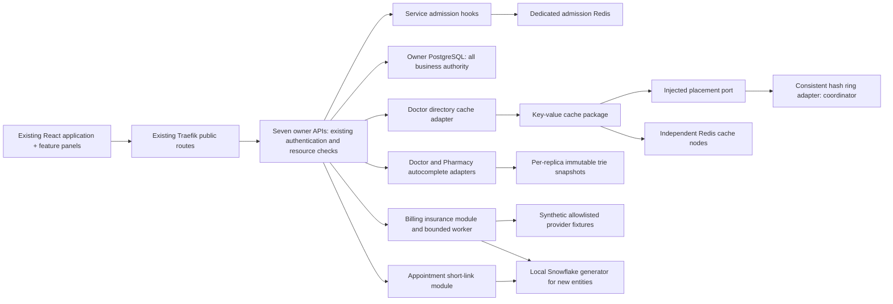

# Phase 4 component contract freeze

Status: **Phase 4.0 preparation only**, 2026-10-12. Inspected clean main
`340909aade79b23a3ffb99ade8d9863bd0a6b928`. These are binding interfaces for
later implementation, not claims of deployed algorithms. The common development
base is the local commit containing this freeze (resolve with `git rev-parse main`
after preparation); no agent launches are authorized by this document.

Companions: [parallel plan](phase-4-parallel-plan.md),
[benchmarks](phase-4-benchmark-plan.md), [ownership manifest](phase-4-ownership.json),
[Phase 2 contracts](phase-2-api-contracts.md),
[activated Phase 3 contracts](phase-3-api-contracts.md),
[Phase 3 verification](phase-3-integration-verification.md),
[security](security.md), and [service boundaries](service-boundaries.md).
This freeze supersedes older phase sequencing for the seven algorithms only.
RabbitMQ business delivery, Surge Mode (Phase 6), Control Room and full-system
load/scalability (Phase 8) remain deferred.

## Inspected foundation and compatibility

| Area | Current implementation and integration seam |
|---|---|
| Patient | `patient_service/main.py`, `authentication.py`, `authorization.py`, `management.py`; Argon2id, in-memory browser JWT, CSRF, rotation, current authority; preserve all handlers |
| Doctor | `doctor_service/api/doctors.py`, `repository.py`; authenticated `/api/v1/doctors` with q/specialty/active/cursor/limit and specialties; proposals remain Doctor-owned |
| Appointment | `appointment_service/phase3_core.py`, `operations.py`, `features/{waitlist,checkin,queue,journey}`; PostgreSQL booking/offers/QR/queue/journey transactions and worker remain authoritative |
| Records | `records_service/api/clinical.py`, `storage.py`; assigned consultation gate, immutable revisions and grants; no Phase 4 content cache |
| Pharmacy | `pharmacy_service/api/router.py`; authenticated medicine prefix queries plus live stock-derived availability; never cache that stock flag or dispense authority |
| Billing | `billing_service/api/billing.py`, `models.py`; invoices/charges/payments active; insurance_providers/crawler_runs/insurance_rules/insurance_estimates already exist, but no insurance HTTP workflow |
| Emergency | `emergency_service/commands.py`; current `_new_id` uses CSPRNG and PK backstops, not Snowflake despite a worker parameter and dormant last_sequence column; separate admission budget |
| IDs | Most owners use positive signed BIGINT CSPRNG; Records uses `records_domain_ids`; Appointment histories use owner sequences. No destructive replacement, rewriting, parsing format assumptions or sequence reset |
| Infrastructure | `compose.yaml`: seven owner DBs on PostgreSQL 16, Redis 7 AOF/noeviction on private backbone, RabbitMQ idle; APIs on edge/database, not backbone. Traefik file routes, trusted proxy IP, no public admin/internal/metrics, no access logs |
| Frontend | `src/app/App.tsx`, `navigation/workspaces.ts`, `api/client.ts`, `auth/authContext.tsx`, hospital/advanced panels; `/s/` already proxied by Vite and routed to Appointment by Traefik, but shortener unimplemented |

Current migration heads: Patient `0005_waitlist_eligibility`, Doctor
`0004_doctor_management`, Appointment `0009_phase3_registration_history`, Records
`0005_phase3_workflow`, Pharmacy `0004_phase3_workflow`, Billing
`0004_phase3_workflow`, Emergency `0003_emergency_workflow`. These source heads and
existing metadata, grants and constraints are retained. Historical documents
containing empty-foundation assumptions are not current implementation claims.

## Integration architecture and common boundaries



Algorithms under `components/` are independently packaged **technical** libraries,
not domain models, an eighth service, a shared ORM or universal business runtime.
Each package has its own pyproject, tests and optional dependency lock. Service
adapters use only their owner's database and security helpers. Do not import a
sibling component at agent time: use the ports specified below. Coordinator owns
composition, pinning package artifacts per consuming image, deployment and route
mounting. Existing Docker contexts copy only their service; shared packages will
require coordinator-reviewed root build contexts with explicit COPY allowlists
or prebuilt wheels. Never copy root secrets into images.

All algorithm operations are bounded; errors are typed, not leaked exceptions.
Async means an awaited coroutine; pure ring/trie methods are synchronous. Integers
are Python ints; wire `ID` is a canonical positive decimal string within signed
BIGINT, `Version` a positive JSON safe integer, `Time` UTC RFC3339, `Minor` an
integer 0..9007199254740991 and currency `INR`. Inputs reject unknown fields,
duplicated query keys, invalid enums, overflow and arbitrary URLs. New GETs are
side-effect-free except required audit append. Domain POSTs use existing
Idempotency-Key and If-Match protocols, safe envelopes, ETag, request/correlation
IDs and tracing. No public actor headers. Secret issuance never saves raw tokens
in idempotency responses; equal-key replay is 409 `token_response_unavailable`
with only resource_id, body mismatch remains 409 `idempotency_conflict`.

New public reads require the owner's existing user JWT verification and RBAC;
privileged writes require current Patient authority before local locks. Internal
service calls retain exact caller/scope/audience/delegation checks; no new
cross-owner leaf is required. A token, reference ID, trie hit or cache hit grants
no access. Mutation/outbox/audit/sanitized idempotency response is one owner
transaction. No Redis calls, crawler fetches or remote authority checks while
business DB locks are held. No new event publication/consumer in Phase 4.

Metrics port (owned locally by each component; structural compatibility only):
`increment(name: str, labels: Mapping[str,str], value: int=1) -> None`,
`observe(name: str, seconds: float, labels: Mapping[str,str]) -> None`,
`gauge(name: str, value: float, labels: Mapping[str,str]) -> None`.
Observer failure is swallowed and cannot fail a business operation. No-op observer
for tests. Names below are prefixed `pulsegrid_`; counters end `_total`, latency
histograms `_seconds`. Allowed labels: component, owner, policy, outcome, backend,
kind and configured node_id/worker_id in bounded experiments; never identities,
raw keys, tokens, prefixes or full URLs. Percentages/ratios are derived from counts
with a defined denominator; zero denominator is null, not 100 percent.

Every module exposes `async health() -> {state: "ok"|"degraded"|"disabled", reason:
str|null}` (pure libraries may expose synchronous health). Existing liveness
remains process-only and owner PostgreSQL readiness remains authoritative.
Cache/trie/crawler degradation does not fail service readiness. ID failure
blocks only commands configured to use it. Admission health records fallback,
not blanket service unready. No new public health payload fields until integrator
reviews compatibility; private diagnostic leaves/metrics stay off the gateway.

## 1. Distributed rate limiter

Agent 1 package: `components/rate_limiter/`, import `pulsegrid_rate_limiter`.
No HTTP service and no Traefik ForwardAuth dependency. Traefik retains routing,
trusted client-IP forwarding and token-path log suppression. Service admission
runs before expensive work but never establishes identity or replaces CSRF.
Coordinator supplies pre-auth source gates and post-auth principal gates after
existing JWT validation. Route classification uses method plus matched route
template (or reviewed exact auth allowlist), never raw path/ID labels.

Frozen Python interface:

```python
# Locally defined immutable dataclasses; no shared runtime types required.
BucketSpec(policy_id: str, capacity: int, refill_milli_tokens_per_second: int,
           cost: int, idle_ttl_ms: int)
BucketRequest(key_digest: str, spec: BucketSpec)
Admission(allowed: bool, retry_after_ms: int | None, remaining_milli_tokens: int,
          mode: Literal["redis", "local"], reason: Literal["accepted", "limited", "unavailable"])
async admit(buckets: Sequence[BucketRequest]) -> Admission
```

Consume all applicable buckets atomically in one bounded Lua operation on the
**same dedicated Redis**, max 3 buckets/request: source, principal and policy
aggregate. Denial consumes none. Use server TIME, clamp elapsed >=0, fixed-point
milli-tokens, refill cap and ceil-rounded retry deadline for the most restrictive
bucket. Validate positive capacity/refill/cost, cost <=capacity, numbers within
Lua exact-integer range 2^53-1 including refill products; bound idle time before
multiplication. Expiry at least ceil(capacity/refill) plus slack so deletion
cannot refill a depleted active bucket prematurely. Namespace keys
`pg:admission:v1:<policy>:<HMAC-SHA256(identity)>`; configured secret stays out of
Git. Atomic Lua execution serializes Redis operations, but scripts do not undo
prior writes on runtime errors: validate key types/config and all decisions
before mutation; bound script loops. See [Redis scripting](https://redis.io/docs/latest/develop/programmability/eval-intro/).

Config: enabled=false until integration; Redis endpoint/credential references;
connect and command deadlines 50ms each, total decision <=100ms; policy version;
HMAC secret; max_replicas; local bounded-key capacity=10000; no transport retries
after an ambiguous consumption (no double-charge). NOSCRIPT recovery may load
and retry only the unexecuted script within the deadline. Redis outage/OOM/BUSY/
timeout selects conservative process-local buckets with capacity and refill
`floor(shared/max_replicas)` (min1, reject invalid configuration if budgets cannot
be partitioned), fixed nonresetting monotonic state and bounded key accounting.
Unknown identity cardinality beyond bound rejects untracked new keys. Each
process is a replica for these bounds. Local aggregate caps prevent bypass through
new source identities. No exact cluster quota guarantee during transitions,
partitions or restarts; record mode transitions and test recovery without granting
a fresh burst on each timeout. No unbounded fail-open. Limiter memory/config
failure returns safe 503 `admission_unavailable`, Retry-After 1; exhaustion returns
429 `rate_limited`, Retry-After max(1,ceil(ms/1000)). Accepted token use remains
consumed even if business validation later fails. Idempotent replay is still a
request subject to admission; business effects stay exactly locally deduplicated.

Proposed initial policy budgets (capacity/refill requests per second; cost1),
configuration values to benchmark and review, **not measured safe limits**:

| Policy | Identity and aggregate partitions | Capacity / refill |
|---|---|---|
| auth_registration | trusted source IP digest; own auth aggregate | source 5/0.1; aggregate 50/5 |
| auth_login | source plus HMAC of owner's normalized account input; generic errors | source 10/0.5; account 5/0.1; aggregate 100/10 |
| auth_session | verified source for refresh/CSRF; JWT principal for logout when available | source 30/2; aggregate 300/30 |
| directory_search | validated user per Doctor/Pharmacy owner | principal 60/10; aggregate 600/100 |
| appointment_command | validated user; booking/waitlist/offer commands | principal 30/5; aggregate 300/50 |
| critical_staff | validated staff, separate per owner and route family: check-in, consultation, dispensing, payments | principal 120/20; aggregate 1200/200 |
| emergency_public | trusted source, own Emergency submission partition | source 5/0.2; aggregate 100/20 |
| emergency_authenticated | validated principal, isolated from public submissions | principal 30/5; aggregate 600/100 |
| emergency_staff | current authorized staff, own Emergency mutation partition | principal 120/20; aggregate 1200/200 |
| owner_read / internal_worker | validated user or verified service, separate owner/role-family partitions | principal 120/20; aggregate 1200/200 |

No one hospital-wide bucket. Public emergency exhaustion cannot consume staff or
authenticated emergency capacity. Other owners cannot consume Emergency budgets.
Internal authority/reconciliation uses its own service budget; low auth quotas
must not deadlock current-authority checks. Invalid JWT uses source budgets and
still returns existing 401 semantics if admitted. Pre-auth source gates use distinct `preauth` policy keys; post-auth compound
buckets use separate keys and do not debit the same bucket twice. Label the
observer policy IDs accordingly and compute request rejection rates from final
admission outcomes, not sum of both stages. Source is trusted Uvicorn peer
handling, never arbitrary X-Forwarded-For; proxy absent/misconfigured means a
conservative source bucket. Account normalization uses Patient's helper only;
limiter accepts a supplied digest and never parses passwords. Logout/local UI
clear remains possible; a rejected server logout retains existing semantics.
Health/ping and OPTIONS are exempt; unknown routes use bounded source gates, not
an exemption. Coordinator must freeze a complete route-policy inventory before
activation, including existing Records access. No priority/triage or Surge Mode.

Metrics: `admission_requests_total{policy,outcome,backend}` accepted/limited/
unavailable; `admission_duration_seconds`; `admission_mode_transitions_total`.
Rejection percentage=limited/(accepted+limited); report unavailable separately.
Throughput=completed admission decisions/wall time. Real Redis multi-client tests
must prove aggregate bound, fractional refill, all-or-none debit and isolated
emergency partitions. Mocks cannot prove script concurrency.

## 2. Consistent hashing

Agent 2: `components/consistent_hashing/`, import `pulsegrid_consistent_hashing`.
Pure placement library: no Redis client, health pings, cache values or replication.

```python
Node(node_id: str)  # stable ASCII identifier, no credentials/address
RingSnapshot(epoch: int, virtual_nodes: int, node_ids: tuple[str, ...])
HashRing(snapshot: RingSnapshot)
HashRing.locate(key: bytes) -> str
HashRing.with_node(node: Node, new_epoch: int) -> HashRing
HashRing.without_node(node_id: str, new_epoch: int) -> HashRing
HashRing.snapshot() -> RingSnapshot
```

SHA-256, full 256-bit unsigned big-endian positions, versioned byte framing:
key hash=SHA256(b"pg-ring-key-v1\0"+key); virtual node hash=
SHA256(b"pg-ring-node-v1\0"+node_id ASCII+b"\0"+decimal vnode index ASCII).
Index 0..virtual_nodes-1. Sort by (position,node_id,index); choose first position
>= key hash and wrap. Duplicate IDs rejected; colliding positions use that tie
order. Empty ring raises `NoNodes`; removing absent node/add duplicate or
nonincreasing epoch raises `InvalidTopology`. Immutable snapshots, concurrent
reads safe. Default 128 vnodes, allowed1..4096, max32 nodes. IDs match
`[a-z][a-z0-9_-]{0,31}`. No Python hash(), random salt, IP-derived node identity
or automatic health-driven topology edits. Golden fixtures are generated by the
specification and checked by Agent 2, not changed by Agent 3.

Modulo baseline uses the **same key hash**, sorted node IDs, hash%N. Measure
1->2, 3->4 and 4->3; key movement counts changed logical node_id, not vnode.
Metrics/benchmark outputs: key_count per node, max/mean load, coefficient of
variation, changed_keys/total, lookup duration and build duration. No HA claim.

Coordinator adapter implements Agent 3's structural placement port; node_id maps
to private Redis connection configuration outside this package. HashRing epoch
is cache namespace generation, not replication version. Every replica receives
the same reviewed node list/epoch before cache enablement. On add/remove switch
namespace and refill from PostgreSQL; no dual reads or automatic reassignment to
another node on timeout. Old keys expire. Node outage selects DB fallback, while
static ring remains unchanged until an explicit coordinator topology rollout.

## 3. Key-value cache

Agent 3: `components/key_value_cache/` import `pulsegrid_key_value_cache`, plus
Doctor adapter `doctor_service/features/directory_cache/`. Only authenticated
active Doctor directory results, minimal id/display_name/specialty IDs/names.
Exclude staff_user_id, inactive/admin queries, patient profiles, records, stock,
schedules, availability, prices, authority, payments and appointment responses.
Existing Doctor response shape and DB pagination remain unchanged: adapter may
cache an allowlisted projection, then owner reconstructs wire response with
fresh owner-only fields; it must not add or suppress fields. Initial integration
may use cached name/specialty projection for a **new autocomplete read** plus
existing active directory listing only after parity tests.

```python
# Agent 3 defines Protocol; Agent 2 need not import it.
Placement.locate(key: bytes) -> str
Placement.epoch -> int
CacheEntry(payload: bytes, source_version: int, expires_at_ms: int)
async Cache.get(key: bytes) -> CacheEntry | None
async Cache.set(key: bytes, value: CacheEntry, ttl_ms: int) -> None
async Cache.delete(key: bytes) -> None
async Cache.get_or_load(key: bytes, loader: AsyncCallable[[], CacheEntry]) -> CacheEntry
async Cache.close() -> None
```

Constructor receives placement, node_id->client mapping, observer and clock.
Agent uses single-node fake placement in tests; no sibling import. All physical
operations use current epoch plus logical key; missing node raises typed
`CacheUnavailable`. Miss is absent/expired/corrupt/schema mismatch; unavailable
is counted separately and get_or_load invokes owner loader. A loader DB failure
is propagated as existing owner 503, never disguised as empty success. Set/delete
errors cannot undo a committed domain mutation. Maximum serialized entry64KiB,
TTL default30s/max60s, node connect/command50ms, total cache attempt100ms,
max inflight loaders32 per process, finite wait100ms; overloaded cache path can
bypass cache into existing bounded DB pool, never unlimited new DB connections.

Key=owner/schema/visibility partition/owner directory revision/normalized filters/
cursor/limit encoded with canonical JSON sorted keys, UTF8 then SHA256; namespace
`pg:cache:v1:<owner>:<epoch>:<digest>`. Never raw personal identities or queries in
keys/logs. Application entry includes projection schema version and DB revision;
Redis TTL enforces expiry, application validates expiry. Do not assume Redis
values/versions trustworthy; validate shape/bounds on every hit.

Coordinator adds a Doctor-owned `directory_revision` singleton (see migration
section): directory/specialty mutation increments it **in the same DB transaction**.
Before cache lookup owner reads current revision from PostgreSQL; reads source
projection and revision in one consistent owner transaction on miss. A late
loader can only populate an old-revision key, not resurrect current stale data.
This intentionally retains a cheap PostgreSQL read per request. Delete is an
optimization; cross-replica validity depends on durable revision plus TTL, not
best-effort delete, Pub/Sub or an unimplemented outbox consumer. Ring epoch shifts
invalidate namespace independently. Auth runs before lookup, and all authoritative
mutation checks bypass cache. Cache never serves stale-on-error. Coordinator
imports existing Doctor helpers; agent exports `load_projection(session, filters)`
and `cache_projection(cache, revision, filters, loader)` and documents mounting.
No owner mutation router edits by Agent 3. Metrics: `cache_requests_total{outcome}`
hit/miss/unavailable/bypass, lookup seconds, load seconds, invalidations total;
hit/miss ratios use successful lookups; report failure/bypass denominators separately.

## 4. Unique ID generator

Agent 4: `components/unique_id/`, import `pulsegrid_unique_id`. Epoch
`2026-01-01T00:00:00Z`; layout `((utc_ms-epoch_ms)<<22)|(worker_id<<12)|sequence`,
41-bit timestamp/10-bit worker/12-bit sequence. IDs positive signed BIGINT; time
before epoch/overflow rejected. Worker=(service_code<<7)|replica_code, codes
Patient0, Doctor1, Appointment2, Records3, Pharmacy4, Billing5, Emergency6,
replicas0..127. Infrastructure assigns codes explicitly per **process**, not DNS
hash or default0; no reuse across concurrently active owners. Spare service7 unused.

```python
Reservation(start_ms: int, end_ms: int)  # inclusive absolute UTC ms
WorkerStore.open(worker_id: int) -> Awaitable[None]
WorkerStore.reserve(worker_id: int, now_ms: int, span_ms: int) -> Awaitable[Reservation]
WorkerStore.assert_owned(worker_id: int) -> Awaitable[None]
WorkerStore.close() -> Awaitable[None]
async Generator.start() -> None
async Generator.next_id() -> int
async Generator.close() -> None
Generator.decode(value: int) -> {timestamp_ms: int, worker_id: int, sequence: int}
```

Agent 4 supplies an owner-DSN-configured PostgreSQL store, never foreign DB
credentials, plus fake store for deterministic tests. Dedicated session obtains
`pg_try_advisory_lock(74104, worker_id)`; duplicate active owner fails closed.
Reservation uses an independent committed transaction in the owning DB:
lock/create id_worker_state row; start=max(now_ms, previous_reserved_through+1);
end=start+span_ms-1; persist end and commit **before** issuing any range IDs.
Default span100ms/max1000ms. Generator waits until wall clock >=start; emits only
for actual eligible UTC ms <=end, never advances fake future timestamps. On
restart skip entire previously reserved range, so crash after emission but before
business commit cannot repeat IDs. Gaps expected. Sequence0..4095, serialize
concurrent next_id calls, overflow waits cancellably for next real ms with total
max wait2000ms then `IdUnavailable`. Rollback of wall clock below last observed
ms poisons generator until explicit restart; no offset concealment. Monotonic
strictly within one generator/worker; different workers are time-sortable, not
a total globally monotonic order.

Ownership check on dedicated connection before each issued batch (Phase 4
next_id batch size1); session loss/error poisons generator, never reconnect
silently. A previously reserved disjoint range also fences late output from a
partitioned old process against replacement worker ranges. PostgreSQL outage
blocks new IDs; no Redis or local random fallback. New commands must allocate
IDs **before** business locks/transactions; reservation must survive domain
rollback. Dedicated locks last for the session, not transaction; see
[PostgreSQL 16 advisory locks](https://www.postgresql.org/docs/16/explicit-locking.html#ADVISORY-LOCKS).
Account for these extra DB connections when configuring replicas.

Rollout: shadow/benchmark first; activate only new short_link and insurance run/
rule/estimate entity tables after store/restart/collision tests. Preserve all
existing entity/audit/outbox IDs and their CSPRNG/sequences and URLs. Even future
new Snowflake values can collide with legacy random IDs in mixed tables: PK
backstop plus at most3 fresh attempts after **whole command rollback**; don't
retry other integrity violations. No global uniqueness claim across legacy
IDs. New Phase 4 entity tables use generator exclusively and stable business
uniqueness. No runtime format dispatch from ID bits; IDs remain opaque strings.
Configuration: worker_id required when enabled, epoch immutable, deadlines above,
owner DSN reference and observer. Disabled hook uses existing generator only for
legacy entities. Agent 5/6 accept injected `async allocate_id() -> int` with a
bounded test allocator; coordinator injects Agent 4 later. No public ID endpoint.
Metrics: generated/collisions/rollback/overflow/ownership-loss totals, generation
seconds, IDs/s and per-worker counts. Health degraded if poisoned/unowned.

## 5. URL shortener

Agent 5: `services/appointment/appointment_service/features/short_links/`.
New aliases are **navigation references**, not check-in credentials. Existing
22-character QR secret/fragment contract and redemption remain untouched.
Short alias=random128 bits, fixed22-character Base62 with the existing alphabet;
SHA256 digest at rest and unique constraint, max3 collision attempts. No sequential
base62 entity IDs, encoded medical data, arbitrary destination URLs or raw QR
secret persistence. Coordinator reserves `short_links` after existing checkin
locks and before waitlist/queue/journey/audit in canonical Appointment lock order.

```python
register_routes(app, ports) -> None
register_tables(metadata) -> None
schema_spec() -> dict  # handoff, not executable migration
async revoke_for_booking_change(session, context, appointment_id) -> None
# Ports supplied by coordinator: existing authorization, command/lock context,
# audit/outbox/idempotency, fresh workflow lookup, allocate_id; no own commit.
```

| Method/path | Input / successful output | Scope and semantics |
|---|---|---|
| POST `/api/v1/appointments/{appointment_id}/short-links` | `{purpose:"appointment"\|"check_in"}` ->201 `{id,appointment_id,purpose,short_path,expires_at,version}` | Own patient or current receptionist; workflow If-Match and idempotency; workflow must exist, confirmed/booked for check_in |
| POST `/api/v1/appointments/{appointment_id}/short-links/{link_id}/revoke` | `{}` ->200 `{id,appointment_id,purpose,expires_at,revoked:true,version}` | Same owner/reception; link If-Match; idempotency; repeat remains revoked |
| GET `/s/{alias}` | No query ->200 `{appointment_id,purpose,landing_path,expires_at}` | Existing user JWT required; own patient/current receptionist; no consume/issue on GET; patient landing path `/patient/appointments` or `/patient/check-in#appointment_id=<ID>`; receptionist path `/receptionist/appointments#appointment_id=<ID>` |

Authenticated API resolution returns JSON. Browser opens the
same-origin alias route, clears it with history replacement before login;
missing JWT401, mismatched scope/unknown/expired/revoked404 with identical error;
authorized creation invalid state409. For login preserve alias only in memory;
reload/loss requires reopen link. Resolution uses no-store/no-referrer, no token
logging. Browser navigation (GET Accept text/html) returns 303 to the fixed same-origin
SPA route `/short-link#alias=<ALIAS>` after shape validation only, with
no DB lookup or resolved appointment information. This carries only the random
alias; it cannot authorize anything. API resolution (GET Accept application/json,
or default) follows the table and requires JWT. Agent 5 implements this static
navigation response; Agent 8 exports ShortLinkLanding, coordinator mounts its
literal authenticated SPA route outside patient-only workspace gates (patient
or receptionist) before generic workspace pages. Landing immediately clears
the fragment, authenticates, then explicitly fetches JSON resolution with alias
in memory; losing memory across login/reload requires reopening the original
link. No automatic QR issuance/consumption. Existing Vite /s proxy is sufficient;
production must preserve that same-origin routing. Allow only fixed destinations,
reject malformed aliases404 and use no-store/no-referrer on both responses.
Navigation 303 latency and authenticated lookup latency are separate metrics;
real browser validation is required before activation.

Appointment purpose expires min(now+24h, starts_at+15min), only future confirmed
appointments; check_in purpose min(now+24h, existing workflow window end).
Reissue revokes previous unrevoked alias for appointment/purpose under parent
locks (including expired rows). Reschedule/cancel/no-show/QR workflow completion
revokes aliases through participant; expiry checked against DB time on every
resolve. Resolution rechecks current appointment/workflow, ownership and version
binding; aliases are reusable navigation until expiry/revocation. They never
check in. Check-in landing fetches workflow and requires explicit existing QR
secret scan/paste or authorized existing staff fallback with reason, then POST
through Phase 3. Obtaining a new QR requires explicit existing issuance POST,
not an automatic GET/reissue. Queue/idempotency/window safeguards are preserved.
Token issuance response short_path kept only in memory; sanitized replay409.
Metrics: short_link_created/resolved/collisions totals, create/resolve seconds,
lookup throughput; navigation redirect and authenticated resolution latency are reported separately. No sensitive labels.

## 6. Synthetic insurance crawler and estimates

Agent 6: `services/billing/billing_service/features/insurance/`. Billing-owned
asynchronous worker and deterministic fixture generator, no new microservice or
patient fetch. May run worker in the existing Billing lifespan later. Fixture
HTTP serving is internal test infrastructure, not a public insurer proxy.

```python
async crawl(provider_id: str, fetcher, repository, observer) -> CrawlOutcome
extract(html: bytes, source_id: str) -> tuple[PolicyRule, ...]
validate(rule: PolicyRule) -> PolicyRule
estimate(invoice_snapshot, rule: PolicyRule, now) -> EstimateResult
register_routes(app, ports) -> None
register_tables(metadata) -> None
schema_spec() -> dict
async worker_tick(ports) -> None
```

PolicyRule=`{policy_code:str,revision:Version,effective_from:Time,effective_to:Time,
currency:"INR",coverage_bps:int,deductible_minor:Minor,max_benefit_minor:Minor,
covered_charge_codes:[str]}`; policy_code1..64 safe ASCII, bps0..10000,
effective_to>effective_from, <=100 distinct charge codes, only consultation or
`medicine:<canonical ID>`. Unknown fields rejected. Each provider has one chosen
active policy_code per estimate, no arbitrary patient plan lookup. Canonical
JSON SHA256 for content; dedup by provider/policy_code/revision and content hash.
Same revision different content quarantined (`source_revision_conflict`), never
overwrite accepted rules. Page duplicates counted; fixture truth file defines
expected extraction and injected corrupt pages.

| Method/path | Input / output | Authorization |
|---|---|---|
| GET `/api/v1/billing/insurance/providers` | cursor/limit default20 max100 -> `{items:[{id,synthetic_slug,last_success_at:Time\|null}],next_cursor}` | current billing_staff or hospital_admin; no allowlisted_url in wire |
| POST `/api/v1/billing/insurance/providers/{provider_id}/refresh` | `{}` ->202 `{run_id,provider_id,state:"pending",version}` | current billing_staff/admin, provider If-Match + idempotency; durable request, no input URLs |
| GET `/api/v1/billing/insurance/runs/{run_id}` | -> `{id,provider_id,state:"pending"\|"running"\|"complete"\|"partial"\|"failed",pages_processed:int,error_code:str\|null,version}` | current billing_staff/admin; no raw page/error text |
| POST `/api/v1/billing/invoices/{invoice_id}/insurance-estimates` | `{provider_id:ID,policy_code:str}` ->201 EstimateResult | own patient or current billing_staff; invoice If-Match+idempotency; server reads owner invoice |
| GET `/api/v1/billing/invoices/{invoice_id}/insurance-estimates` | cursor/limit -> `{items:[EstimateResult],next_cursor}` | same invoice scope as existing invoice GET |

EstimateResult=`{id:ID,invoice_id:ID,invoice_version:Version,provider_id:ID,
policy_code:str,rules_id:ID,rule_revision:Version,source_run_id:ID,
currency:"INR",eligible_minor:Minor,estimate_minor:Minor,calculated_at:Time,
freshness_state:"fresh"|"stale",is_simulated:true,version:Version}`.
No approved/guaranteed coverage claim. Exact integer calculation:
eligible=sum current immutable invoice item amounts whose charge_code is covered;
benefit=min(max_benefit_minor, max(0,eligible-deductible_minor)*coverage_bps//10000,
current unpaid balance). Snapshot invoice version/source membership with the
estimate in a Billing transaction after any remote work; paid invoice gives zero,
adjustments not traceable to an eligible item excluded. Rule must be effective
now; latest effective accepted revision chosen. No valid rules409
`insurance_rules_unavailable`; provider/rule conflict409; stale source older than
24h may produce stale-labeled estimate, never automatic refresh/wait or blocking
payment/consultation/discharge. Read evaluates freshness dynamically, including
invoice-version changes. This estimate never changes total_minor/paid_minor,
posts charges or enters journey discharge predicates.

Fetcher accepts **only configured fixture provider IDs**, coordinator seed of
three fixture hosts/ports. Resolve and validate allowlisted hostname, port and
IP at each request/redirect, disable environmental proxies, reject credentials,
fragments, non-HTTP fixture schemes and all arbitrary external/metadata hosts.
Allowlisted synthetic private host IPs are explicitly permitted; DNS must remain
bound to approved fixture addresses. Limits: concurrency4 global/2 per host,
request timeout1s, run deadline30s, <=100 pages/run, depth2, redirects2,
response256KiB (decompressed), retries2 with bounded jitter100..500ms for connection,
429/5xx only; respect Retry-After within run deadline. No scripts execution,
no recursive arbitrary links. Failed/invalid source does not replace last-good
rules. Run statuses/counts record partial failure honestly. Worker leases30s,
claim bounded batch4 with SKIP LOCKED in a short DB transaction, increment fencing
version; fetch outside locks; finalize only if lease version still owned. Durable
retry scheduling survives restart; at most one active run/provider; duplicate
refresh replays same durable run. Audit/outbox/result per local transaction,
no broker publication. New entity IDs are injected via allocate_id port.
Config: enabled=false, provider allowlist/fixture addresses, limits above,
freshness24h and poll5s; no crawler access to other DBs. Health degraded on recent
failed runs, not Billing unready. Metrics: crawler pages/deduplicated/failed totals,
run seconds, extraction valid/expected counts, estimate seconds. Raw pages retained
only in ignored bounded test artifacts; persisted provenance is content hash and
allowlisted source identity, never patient data.

## 7. Trie autocomplete

Agent 7: `components/autocomplete/` import `pulsegrid_autocomplete`, Doctor and
Pharmacy `features/autocomplete/` adapters. One pure trie with immutable published
snapshots per owner replica, no cross-owner import/DB read. Doctor suggestions
contain active doctor names and visible specialties; Pharmacy only active medicine
catalog names. No stock/price flags, staff contacts, inactive records, prescriptions
or patient names. Auth runs before search; exact existing authenticated directory
visibility enforced. Current-owner row revalidation before returning IDs prevents
inactive/deleted hits even if a replica index has not yet refreshed.

```python
Suggestion(id: str, kind: Literal["doctor", "specialty", "medicine"], label: str)
Trie.insert(suggestion: Suggestion) -> None
Trie.remove(kind: str, id: str) -> None
Trie.search(prefix: str, limit: int, kinds: Sequence[str]) -> tuple[Suggestion, ...]
IndexSnapshot(generation: int, trie: Trie)
async rebuild(owner_snapshot_loader) -> IndexSnapshot
register_routes(app, ports) -> None  # per-owner adapter
async refresh_index(ports) -> None
```

Normalize Unicode NFKC, casefold, strip and collapse whitespace; max normalized
prefix100 codepoints, minimum1, no fuzzy match. Stable order=(normalized_label,
kind,numeric ID); distinct(kind,id). Preserve original display label. Limit
1..20 default10; kinds sorted/deduped from owner allowlist. Escape LIKE wildcards
in DB baseline; normalization identical to trie. Empty/blank prefix422,
no hits200 empty. Bounded result enumeration with <=20 cached ordered candidates
per prefix node; remove/rename updates old and new paths and affected candidate
sets, without dropping other ties. Large rebuild occurs off request path and
publishes atomically; do not mutate a live snapshot. Index size/memory limits
configurable (default100000 entries/64MiB estimate); over limit falls back to DB,
never silently omits authorized results.

| Method/path | Query -> response | Scope |
|---|---|---|
| GET `/api/v1/doctors/autocomplete` | prefix, kinds=doctor/specialty (comma separated, default both), limit -> SuggestionPage | authenticated user; active visible directory |
| GET `/api/v1/pharmacy/medicines/autocomplete` | prefix, limit -> SuggestionPage | authenticated user; active medicine catalog only |

SuggestionPage=`{items:[{id:ID,kind:"doctor"|"specialty"|"medicine",label:str}],
index_version:Version|null,source:"trie"|"database"}`; no pagination/cursor,
no-store; index_version null on DB fallback. Literal routes must mount **before**
existing `/{doctor_id}` and `/medicines/{medicine_id}` to avoid shadowing; this is
coordinator-owned entrypoint work. Agent adapters export routers but do not mount.
Unavailable/stale/missing index -> same-order owner DB prefix query; DB outage
uses existing503, not stale trie success. Check owner directory_revision (Doctor)
and catalog_revision (Pharmacy) each request before serving trie. Build from
consistent owner snapshot, compare revision again before publish; mismatch retry
bounded2 then fallback. Mutations bump revision transactionally; background
poll5s discovers replicas' gaps; no reliance on future events. Revalidate selected
IDs in current DB snapshot; source revision change during query triggers DB
fallback, no locks across external calls. Trie normalization is new-route-only;
existing directory search semantics remain unchanged. Metrics: autocomplete query
seconds/outcome totals, index entries/nodes/estimated bytes and rebuild seconds;
P95 measured from raw samples, accuracy exact result equality to frozen oracle.

## Exact adapter ports and lifecycle handoff

Feature `register_routes(app, ports)` mounts into the supplied test app only;
production app calls are exclusively coordinator-owned. It must not construct a
new engine/session pool or install an authentication bypass. `register_tables`
adds feature-owned tables to provided owner metadata without create_all; imports
perform no network work. `schema_spec()` returns a JSON-compatible dictionary
with tables/columns/indexes/constraints/preflight/runtime_grants/audit_actions,
using the current Phase 3 handoff convention. No executable Alembic import.
Owned HANDOFF.md lists exports and pins; unrelated parent __init__ files stay intact.

Owner ports are local Protocol/dataclass definitions with these exact callable
names (implementation adapters translate existing helpers, not new authorities):

```python
# principal/context/session are stable owning-service objects, never foreign ORM.
async ports.authorize(request, roles: tuple[str, ...], resource_id: str | None,
                      write: bool) -> principal
async ports.allocate_id() -> int
async ports.command(request, principal, route_key: str, body: dict,
                    if_match: str | None, operation) -> response
# command: existing idempotency/replay/version/lock policy; operation receives
# (session, context) and returns (status_code:int, safe_body:dict, version:int).
# Token issuance first-response secret is a separately supplied ephemeral
# response overlay; safe_body stored in DB never contains alias/QR secret.
ports.read_session() -> AsyncContextManager[session]
ports.observer  # common metric methods above
```

Appointment additional ports: `read_workflow(session, appointment_id) -> dict`,
`lock_context(session, request, principal, appointment_id) -> context` and
`stage_effect(session, context, action, resource_id, version, payload) -> None`.
Coordinator command adapter determines complete canonical lock plan before
operation; short_links row locks cannot be taken after audit/queue locks.
`ports.token_response(safe_response, ephemeral_fields: dict) -> response` overlays
secrets only on the first committed issuance; replay path retains409 behavior.
Alias creation does **not** increment workflow/booking version or revoke existing
QR secrets; it binds the current workflow version and changes only alias state.
Existing QR reissue may invalidate a version-bound alias; return safe404 then
explicitly reissue alias rather than weakening QR version guards.

Billing additional ports: `read_invoice(session, invoice_id) -> dict` including
version, balance and local charge-code items; `read_provider(session, provider_id)
-> dict`; `claim_runs(session, now, limit) -> tuple[dict,...]`;
`fetcher.fetch(source_id, relative_path) -> {body:bytes,status:int,headers:dict}`.
Provider/run repository belongs entirely to Agent 6's module; stable owner audit/
outbox primitives are invoked through the adapter. Mutable run fencing is checked
under locks before finalization. Snapshot/claim/finalize transactions never span
fetch; source/dependency errors retain safe codes. Owner clocks are injected for
algorithm tests but production expiration uses PostgreSQL time.

Doctor cache/autocomplete and Pharmacy autocomplete additional ports:
`read_revision(session) -> int`, `load_snapshot(session) -> (revision, entries)`,
`prefix_query(session, normalized_prefix, kinds, limit) -> tuple[Suggestion,...]`,
`filter_visible(session, suggestions) -> tuple[Suggestion,...]`. Cache uses its
frozen filtered projection loader rather than a foreign service port. Index
build/revalidation and revision read use consistent owner snapshots. A stale
index/missing selected candidate falls back to full DB topK (not underfilled
trie output). Freshness is bounded to the read's snapshot, never a claim of
instantaneous remote revocation. Identity authorization always happens first.

Agent modules may define richer private types but these public port signatures
and wire shapes cannot change independently. Test fake command/read ports are
owned by each agent; they must model replay and lock/version behavior explicitly,
then real owner/DB tests cover actual constraints. Fake port tests alone cannot
prove integrated auth, migrations or booking correctness.

## Coordinator database and infrastructure handoff

Preparation changes **no running infrastructure or schema**; no scaffold or
network connectivity is needed to author/test ports independently. Later
coordinator must review schema_spec manifests against current DB metadata and
write forward migrations, never let parallel agents edit applied revisions.

| Owner / next reserved revision | Required forward addition; compatibility preflight |
|---|---|
| Doctor `0005_phase4_directory_revision` | singleton directory_revision revision>=1; triggers/helper bumps on doctors/specialties/doctor_specialties mutation; restrict runtime manual revision writes; preserves all existing data |
| Pharmacy `0005_phase4_catalog_revision` | singleton catalog_revision revision>=1; bump on medicines name/active/catalog changes, not inventory; same grants/tests |
| Appointment `0010_phase4_short_links` | new short_links(id PK, local appointment_id FK, purpose, token_hash unique, expires_at, revoked_at nullable, workflow_version, schedule_fingerprint, version, created_at, updated_at); positive/range/purpose/hash checks; one unrevoked appointment/purpose partial unique; new audited actions and safe grants |
| Billing `0005_phase4_insurance` | extend existing crawler_runs with counters, lease_owner/lease_until, fencing version, next_attempt_at and bounded status checks; insurance_rules policy_code/content_hash/effective_to and provider/policy/revision uniqueness; estimates invoice_version/provenance/currency/eligible and rule fields as needed; all money/range/local FK checks; restrict accepted rules updates/deletes |

Existing insurance tables may contain dormant rows: preflight content, duplicates,
status vocabulary and policy mappings; unexpected rows stop upgrade for review,
never delete/reset or guess a backfill. Nullable forward fields followed by a
reviewed backfill/constraint are allowed only if needed by retained synthetic
rows. Preserve `insurance_rules(provider_id,revision)` uniqueness for compatibility:
assign provider-wide monotonic storage revision in transaction and keep source
policy revision in rule_data; policy-specific source uniqueness is separate.
Crawler outcomes/wire rule_revision refer to validated **source policy revision**;
rules_id identifies persisted storage revision. Invoice snapshot copies live
charge codes via Billing's own tariff joins, no foreign DB query. One active
crawler run/provider partial unique covers pending/running; expiry leases repair
running rows before reclaim without two finalizers. New enums apply only to
new insurance API; preflight dormant state columns before checks. Preserve all
seven single Alembic heads, audit append allowlists, history/PK/exclusion/stock/
payment/current-authority rules. Worker store reuses existing id_worker_state;
no ID migration required, preserve dormant Emergency last_sequence column.

Later infrastructure: retain existing Redis as **dedicated admission Redis**
(noeviction/AOF, private). Add two cache-only Redis nodes initially, configurable
third/fourth for benchmark topology, private cache network/no host ports,
allkeys-lru and bounded memory, separate authenticated ACLs per owner prefix;
no replication/Redis Cluster/Sentinel or HA claim. Restrict admission ACL to
script/get/hash/expiry/time commands required; deny flush/config/admin, use
credential references. Connect only consuming API processes to admission/cache
networks; migration jobs don't need Redis. Keep RabbitMQ untouched. Provider
fixtures run only on isolated synthetic network accessible to Billing worker;
no host ports or public gateway routes. A later Compose phase4 overlay is
coordinator-owned, disabled by default and validated with existing auth overlay.
Never regenerate existing credentials or overwrite volumes.

Service config is coordinator-mapped `PULSEGRID_<DOMAIN>_PHASE4_*` with per-feature
enabled flags, private endpoint/secret file references and validated bounded
parameters above; no mandatory Redis dependency for existing owner readiness.
Traefik needs no new backend or path prefix: existing /s and domain routers cover
new endpoints; routing/order/SPA landing and trusted-IP tests are still required.
Expose Retry-After in existing CORS allowlists at integration; do not weaken origins
or add actor headers. Dedicated ID connections and cache-miss DB fallback need
explicit connection budgets, resource limits and deadlines; max-replica bound
must be enforced before scaling. Minimal preparation infrastructure changes: none.
