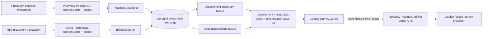

# Phase 5 event contracts

Status: selected contracts and implementation plan, recorded before Phase 5 code
changes. PulseGrid uses synthetic data and remains a single-hospital educational
prototype.

## Scope and existing infrastructure

PulseGrid already has one `outbox_events` and one `inbox_events` table in each
service database. Outbox rows are inserted with business mutations in the same
local transaction. Billing and Pharmacy already write versioned domain events;
Appointment already writes lifecycle events. RabbitMQ is present in Compose on
the private `backbone` network, but no business publisher or consumer currently
uses it. This phase extends the existing outbox and Appointment inbox rather
than adding a second event store.

Only the two event types below will be published and consumed in Phase 5.
Other existing outbox event types remain local until a separately reviewed
consumer workflow is selected. This keeps the deployed subscriptions explicit
and avoids silently discarding messages that have no consumer.

## Selected workflows

| Producer event | Consumer | Consequence |
|---|---|---|
| Pharmacy `pharmacy.reservation.dispensed.v1` | Appointment journey reconciliation | Appointment records the event in its inbox and schedules a fresh owner-snapshot reconciliation for the referenced journey. |
| Billing `billing.payment.succeeded.v1` | Appointment journey reconciliation | Appointment maps the event's appointment reference to its local journey, records the event in its inbox, and schedules fresh owner snapshots. |

These messages are wake-up signals. Appointment fetches current Records,
Pharmacy, and Billing snapshots through the existing authenticated owner APIs,
outside its database transaction, then applies the existing version-fenced
journey projection. Event payloads do not change appointment state, stock,
charges, invoices, payments, queue entries, access decisions, or discharge
eligibility. A stale, duplicated, or delayed event can request an extra fresh
read but cannot regress a source version or complete a stage by itself.



## Event envelope

All published messages use the existing envelope fields and decimal-string ID
convention:

```json
{
  "event_id": "123456789012345",
  "event_type": "pharmacy.reservation.dispensed.v1",
  "schema_version": 1,
  "producer": "pharmacy",
  "aggregate_type": "reservation",
  "aggregate_id": "123456789012346",
  "aggregate_version": 2,
  "occurred_at": "2026-10-12T10:30:00Z",
  "correlation_id": "37a4a810-9b07-4b32-a51a-725e3a0d693c",
  "request_id": "688ceebc-e089-4908-a519-a3cbdcc18c4e",
  "causation_id": null,
  "traceparent": null,
  "payload": {"resource_id": "123456789012346", "version": 2, "state": "dispensed", "journey_id": "123456789012347"}
}
```

`event_id` is allocated by the producing service and remains unchanged through
publish retries, consumer redelivery, and operator replay. The RabbitMQ
`message_id` is the same decimal string. `aggregate_version` is positive and
comes from the owning aggregate. `occurred_at` is UTC RFC 3339. `correlation_id`
and `request_id` are inherited from the originating request.

### `pharmacy.reservation.dispensed.v1`

- Producer: Pharmacy, from the existing reservation dispense transaction.
- Aggregate: reservation ID and post-dispense reservation version.
- Payload: existing `resource_id`, `version`, and `state`; add `journey_id` when
  the locally stored prescription snapshot has one. Historical rows without
  `journey_id` are accepted as legacy signals and acknowledged without a
  reconciliation effect.
- The payload carries no medicine name, prescription text, dosage, diagnosis,
  patient name, or stock ledger details.

### `billing.payment.succeeded.v1`

- Producer: Billing, from the existing simulated payment transaction.
- Aggregate: invoice ID and post-payment invoice version.
- New payload: `appointment_id`, which Appointment uses only to find its own
  local journey. It contains no payment credential, amount, patient ID, or
  charge-source list.
- Historical unpublished rows use the previous proposal payload and may not
  contain `appointment_id`; the consumer acknowledges those rows as legacy
  no-op signals. New producers emit the Phase 5 payload.
- A successful payment event is a signal to read Billing's current owner
  snapshot. It never marks the invoice paid in Appointment.

## Compatibility and validation

The envelope schema version is `1`. Consumers require the expected producer,
event type, aggregate type, positive decimal IDs, positive aggregate version,
valid timestamp, and a JSON object payload. Unknown event types and unsupported
schema versions are permanent failures and go to the dead-letter queue. Within
v1, consumers ignore unknown additive fields. Breaking field removal or changed
meaning requires a new event type/version and a reviewed migration window.

The two new payload fields are additive to the persisted outbox contract. The
pre-Phase-5 broker had no business consumers, so the consumer explicitly
recognizes already-persisted legacy payloads and does not reinterpret them as
current business state. Stable event IDs are preserved; no replacement IDs are
created for retries or replay.

## RabbitMQ topology and delivery

- Durable topic exchange: `pulsegrid.events`.
- Durable queues: `pulsegrid.appointment.journey.pharmacy.v1` and
  `pulsegrid.appointment.journey.billing.v1`, each with one exact routing-key
  binding and a distinct consumer identity.
- Each queue is durable and persistent-message capable. Consumers use manual
  acknowledgments and bounded prefetch.
- Durable direct dead-letter exchange: `pulsegrid.dlx`; each subscription has
  its own durable dead-letter queue.
- Transient failures use bounded backoff and quorum-queue delivery counts. The
  initial attempt is followed by at most five delayed retries (approximately
  1 s, 5 s, 30 s, 2 min, and 10 min). Permanent validation failures go directly
  to the subscription's dead-letter queue. Messages are never immediately
  requeued in an unbounded loop.
- Publisher workers use persistent messages, publisher confirms, mandatory
  routing for selected event types, bounded claim batches, and a finite lease.
  A confirmed publish followed by a publisher crash may result in a duplicate;
  the Appointment inbox makes that safe.
- RabbitMQ remains on the existing internal network and has no host-published
  port. Service connections use a scoped application account, not the broker
  administrator account.

## Database behavior

Billing and Pharmacy retain their existing outbox tables, including event ID,
type, envelope, attempt count, next-attempt timestamp, claim owner, and lease.
The only required outbox schema addition is nullable safe `last_error` metadata
for publisher diagnostics. Claims commit before network I/O; publishers update
delivery state only after a broker confirmation. Expired claims are recoverable.

Appointment reuses its existing inbox primary key `(consumer_name, event_id)`.
For each delivery, envelope validation happens before processing. The inbox
insert and local reconciliation wake-up commit in one Appointment transaction;
the broker acknowledgment follows the commit. A duplicate inbox key is
acknowledged without repeating the wake-up. No external API call occurs while
the inbox transaction is open.

The Appointment journey worker performs the authoritative fresh owner reads.
Its existing source revisions, owner identity checks, audit/history behavior,
and discharge checks remain authoritative. Replayed or out-of-order signals
cannot overwrite those source versions.

## Recovery and observability

`GET /api/v1/appointments/journeys/{journey_id}` remains the user-visible
projection. A successfully consumed signal schedules the existing worker, which
updates `last_reconciled_at` and source-backed stage state after fresh owner
reads. Bounded-cardinality `/metrics` counters expose selected pending/outbox
publishes, publisher failures/retries, consumer processed/duplicate/failure
counts, dead-letter outcomes, and processing latency. Metrics contain no
patient, appointment, invoice, or event IDs.

Operator replay is limited to repaired dead-letter messages. It preserves the
original envelope and event ID, records an operator and reason, publishes with
confirmation to the original routing key, and acknowledges the dead-letter
copy only after confirmation. Consumer inbox deduplication makes a replay safe
when the original effect had already committed.

## Deliberate limits

Phase 5 activates only these two producer-to-consumer paths. It does not publish
the broader proposal catalog, add cross-service database access, modify
authoritative payment or inventory behavior, replace the existing journey
reconciler, introduce event sourcing, or claim exactly-once delivery or broker
high availability. Full throughput and scalability evaluation remain Phase 8.
