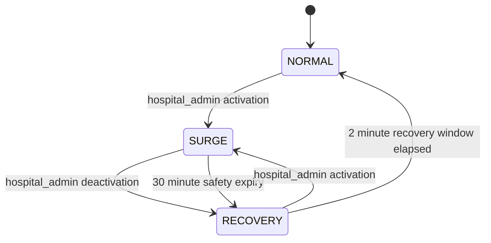

# Phase 6 resilience design

Status: implementation contract for the synthetic, single-hospital PulseGrid
prototype. Phase 6 extends existing service admission and owner recovery paths;
it does not add a service, dashboard, broker, or second limiter.

## Existing reliability mechanisms

- Each FastAPI service has its own PostgreSQL database, bounded SQLAlchemy pool,
  connection pre-ping, pool wait, connection, statement, and readiness deadlines.
  PostgreSQL constraints, locks, local transactions, idempotency records, and
  append-only per-service audit chains remain the authority for business writes.
- The Phase 4 admission component uses one dedicated Redis service and an atomic
  Lua token-bucket decision. It derives source and principal keys server-side,
  has distinct Emergency policies, returns bounded `429`/`Retry-After`, and uses
  conservative divided per-process quotas when Redis is unavailable. That
  fallback is approximate across replicas.
- Doctor's directory cache falls back to Doctor PostgreSQL. Doctor and Pharmacy
  autocomplete use their owner database when the optional trie is unavailable
  or over its memory budget. Cache placement does not replicate data or grant
  mutation authority.
- Phase 5 publishers retain committed outbox messages across RabbitMQ outages;
  publisher confirms, durable queues, bounded delayed retries, dead-letter
  queues, Appointment's inbox, and post-commit owner reads remain in place.
- Appointment journey reconciliation already performs bounded authenticated
  owner snapshot reads outside its database transaction, stores failures as
  pending state, retries from durable local work, and refuses discharge without
  fresh authoritative sources.
- `/metrics` currently renders bounded process-local counters. It is not a
  cross-replica aggregation service. Full Prometheus/Grafana deployment remains
  outside this phase.

## Gaps and selected boundaries

The existing limiter has static route budgets but no shared operating mode or
server-owned priority class. Appointment's snapshot client has a local failure
counter and open timer, two immediate fixed-delay GET attempts, no jitter, and
no concurrency-safe half-open probe limit. Its new HTTP client per attempt also
prevents connection reuse. There is no explicit outbound bulkhead for these
optional journey reads.

Phase 6 will add only these boundaries:

1. Extend the Phase 4 limiter with a Redis-backed Surge Mode record and
   server-assigned operation classes. The same Redis token buckets remain the
   sole admission authority.
2. Put a reusable, process-local CLOSED/OPEN/HALF_OPEN breaker, bounded GET
   retries/timeouts, and a per-owner bulkhead around Appointment's optional
   Records, Pharmacy, and Billing journey snapshot reads. These reads update a
   projection; they do not authorize bookings, prescriptions, dispensing,
   payments, or discharge.
3. Keep RabbitMQ retry and dead-letter behavior unchanged. Do not add retries
   around domain mutations.

No breaker is placed around a critical write, local PostgreSQL operation,
current-role check, or payment/inventory operation. A missing source (404),
business conflict/validation response, authorization response, or admission
429 is not counted as dependency outage. Network errors, timeouts, dependency
5xx responses, and malformed/oversized successful snapshot responses are
counted.

## Operation classes and budgets

The class is selected from the service-owned method and route template. No
request header, body field, query field, token claim, or client identity can
select or raise the class.

| Class | Initial route families | NORMAL | SURGE | RECOVERY |
|---|---|---:|---:|---:|
| A — critical | Emergency request creation and staff claim/lifecycle mutations; Records consultation finalization; Pharmacy dispensing; Appointment clinical-hold finalization | Existing owner budget | 100% of its existing owner budget | 100% |
| B — important | Appointment booking, cancellation, rescheduling and schedule decisions; ordinary authorized clinical and prescription operations; Pharmacy reservation/revalidation; Billing invoice/payment operations; authentication and journey reads | Existing owner budget | 60% | 80% |
| C — deferrable | Doctor directory and autocomplete; Pharmacy catalog browsing and autocomplete; Billing synthetic insurance refresh/estimate operations | Existing owner budget | 15% | 50% |

Class A still has finite per-source and aggregate token buckets. Emergency keeps
its existing isolated policy identities. Route class is included in the bucket
partition so Class C cannot consume a Class A aggregate bucket. The scale applies
to both capacity and refill rate, with a minimum of one token for valid frozen
budgets. Existing unauthenticated source gates remain in front of authenticated
principal budgets.

## Surge Mode policy

The one shared control hash is stored in the existing private admission Redis
namespace. The limiter reads it for each classified admission. NORMAL uses the
existing budgets. SURGE and RECOVERY apply the table above. Each state carries a
monotonic version, UTC transition time, expiry, and a bounded reason code.

- An authorized `hospital_admin` uses Appointment's narrow Surge Mode API. The
  API has no priority override and no dashboard. Current Patient authority is
  checked using the existing service authorization call.
- Minimum SURGE duration is 30 seconds; minimum RECOVERY duration before a new
  activation is 15 seconds. A separately audited administrative override can
  bypass either cooldown. Repeated activation while already in SURGE does not
  extend the safety expiry.
- Manual activation lasts at most 30 minutes. If the controller/service stops,
  all replicas derive RECOVERY for two minutes from the shared expiry, then
  return to NORMAL. A manually requested deactivation enters RECOVERY for two
  minutes. These are deterministic shared-time rules, not process-local mode
  state.
- Authorized transition intent is first written to Appointment's existing
  append-only hash chain. The Redis compare-and-set follows that durable audit
  write; a successful transition is then recorded on the same chain. If Redis
  is unavailable, the API returns 503 and does not claim the requested state
  was applied. If the follow-up audit write fails after Redis applies, the
  durable intent remains and the response reports an uncertain confirmation;
  the returned Redis version can be checked through the authenticated status
  endpoint.
- Redis state is shared across replicas. If Redis cannot be read, the existing
  limiter fallback stays in force and Class B/C use the SURGE budget profile;
  Class A remains finite and isolated. If the limiter itself cannot make its
  bounded decision, its existing safe `503`/local quota behavior applies. No
  authentication, authorization, or business invariant is bypassed.
- Automatic activation is intentionally disabled. The available counters are
  per-process, and there is no deployed shared metrics collector or reliable
  signal that distinguishes aggregate pressure from a single abusive client.
  A `429` alone is not a trigger. Manual activation remains available until
  Phase 8 provides a reviewed aggregated signal.

## Circuit breaker, retry, timeout, and bulkhead settings

The selected boundary is Appointment's GET-only journey snapshot client, one
breaker and bulkhead per owner (`records`, `pharmacy`, `billing`). Settings are
fixed, explicit starting values; the focused verification records observations
without claiming they are production SLOs.

| Control | Setting | Behavior |
|---|---:|---|
| Connection timeout | 250 ms | Bounds socket connection establishment |
| Read timeout | 500 ms | Bounds a downstream read stall |
| Whole logical snapshot request | 1 s | Includes pool wait, attempts, response validation, and delay |
| Attempts | 2 total | One retry for idempotent GET after network/timeout/5xx failure |
| Retry delay | 50 ms exponential base + 0–25 ms jitter | One bounded delay; cancellation propagates immediately |
| `Retry-After` | Honor only when a single bounded 429 retry fits the 1 s deadline | 429 does not count as breaker failure; no retry loop |
| Breaker threshold/window | 3 counted failures in 10 s | Failures are logical requests after the bounded retry policy |
| OPEN cooldown | 5 s | Fast failure during cooldown |
| HALF_OPEN probes | 1 concurrent probe per owner | A successful response closes; a counted failure reopens |
| Per-owner bulkhead | 2 in flight; 50 ms maximum wait | Saturation returns a safe pending source result; permits release on errors/cancellation |
| HTTP pool | 6 total connections, 3 keep-alive | Optional reads cannot consume an unbounded client pool |

Business 4xx, including 401/403/404/409/422 and 429, prove that the owner
responded and do not increase the breaker failure count. A healthy 404 remains
an unknown/pending source. Read-only GET can retry; no POST/PATCH/DELETE is
retried by this policy. RabbitMQ retains its separate Phase 5 delayed retry
schedule and is not wrapped in this HTTP policy.

## Graceful degradation and invariants

- Doctor cache outage continues through Doctor's authoritative PostgreSQL
  fallback; trie outage/over-budget keeps the existing authorized DB search.
- An open journey snapshot breaker or a full bulkhead leaves that source pending
  and uses Appointment's durable bounded reconciliation backoff. It does not
  fabricate a snapshot or authorize discharge.
- Billing insurance keeps only its explicitly fresh persisted synthetic source
  data; an unavailable refresh is not represented as a new estimate.
- RabbitMQ outage leaves owner transactions committed with unpublished outbox
  rows. Recovery reuses the current publisher lease, confirmation, retry, DLQ,
  and Appointment inbox paths.
- A Surge Mode or Redis outage never relaxes authentication, authorization,
  booking/waitlist constraints, QR single-use, Pharmacy stock, prescription
  authority, Billing money, outbox durability, inbox idempotency, database
  isolation, or audit-chain integrity. Unavailable authoritative dependencies
  fail closed.
- Short-link failure never becomes QR authorization or anonymous workflow
  access.

## Audit and observability

Appointment owns the manual Surge Mode API and appends its intent and applied
transition events through the existing Appointment audit hash chain. Events
contain the actor, action, time, reason code, previous/new state, control
version, request ID, and correlation ID. Free-form medical or operator text,
secrets, tokens, patient IDs, and appointment IDs are excluded. Redis outage
and unauthorized requests cannot change mode. High-frequency decisions remain
metrics, not audit rows.

The existing bounded metrics observer will expose current mode by owner,
transition totals by state, admission outcomes by route policy/class, breaker
state/open/failure totals by owner, retry/timeout totals, bulkhead occupancy and
rejections, and snapshot degradation. Labels are limited to fixed owner,
route, class, state, outcome, and dependency values. `/metrics` stays off the
Traefik public gateway.

## Verification criteria

Phase 6 verification uses focused tests plus the retained synthetic Compose
stack without deleting volumes. It must establish:

1. Redis-shared mode changes are visible to more than one service process;
   class-specific quotas and existing Emergency isolation behave as documented.
2. An authenticated hospital administrator can transition state; absent,
   stale, unauthorized, or spoofed priority information cannot escalate a
   request. Audit intent/applied rows are verifiable in the Appointment chain.
3. SURGE expiry and RECOVERY expiry are safe; a Redis outage uses the documented
   limiter fallback and never creates unbounded Class A capacity.
4. Breaker threshold, fast OPEN, one HALF_OPEN probe, recovery, reopening,
   cancellation, and 4xx/429 classification work under concurrent calls.
5. The per-owner bulkhead bounds in-flight optional reads and releases capacity
   after success, error, timeout, or cancellation.
6. A selected dependency outage stays within its deadline, leaves the journey
   pending, then reconciles from owner APIs after recovery. Billing, Pharmacy,
   Appointment booking, and Emergency owner state remain authoritative.
7. RabbitMQ remains compatible with existing outbox/inbox delivery and bounded
   retry behavior.
8. Backend regressions, API readiness, seven owner routes, and selected real
   gateway workflows pass. Any unavailable check is labeled PARTIAL; no result
   is inferred from historical Phase 3–5 evidence.

