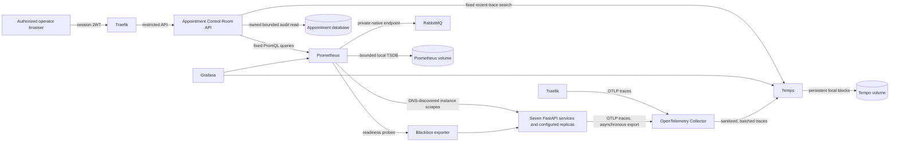

# Phase 7 observability design

Status: Phase 7 implementation is complete for the synthetic single-hospital
PulseGrid prototype. Live results, test counts, and limitations are recorded in
the [integration verification report](phase-7-integration-verification.md).
This phase adds operational visibility; it does not change the authority of
any hospital service or make telemetry a business dependency.

## Checkpoint 2 verification — 2026-10-13

Prometheus v3.13.4 now scrapes the seven APIs by private Compose DNS and also
discovers the configured `doctor_replica`. Its API target labels keep
`service`, `replica_source`, and per-process `instance` distinct. Blackbox
probes each discovered API's existing `/health/ready` route. RabbitMQ's native
Prometheus plugin reports the live Appointment queues, and Traefik exposes
metrics only on its private `:8083` entry point.

Live Prometheus queries returned eight API targets and eight successful
readiness probes: one target for each domain service plus the Doctor replica.
After a bounded `/openapi.json` request to each process, the HTTP counter was
present for all eight targets with the `/openapi.json` route template and
`2xx` status class. A loopback gateway request also produced the Traefik
`web` entry-point request series. RabbitMQ's detailed scrape returned four
queue-ready series, including the two Appointment consumer queues and their
dead-letter queues. The metrics test confirms request paths, query strings,
and readiness probes are not emitted as label values.

`docker compose config --quiet`, Prometheus `promtool check config`, and the
focused metrics tests passed. The existing PostgreSQL, Redis, and RabbitMQ
named volumes remain present; the monitoring stack added dedicated Prometheus,
Tempo, and Grafana volumes. The current RabbitMQ node name is now configured
explicitly so Compose recreation resumes the existing broker state. No
database, Redis, or RabbitMQ data volume was reset.

## Existing instrumentation and boundaries

The seven FastAPI services already expose a private `/metrics` endpoint backed
by a bounded, process-local observer. Phase 4 metrics include rate limiting,
cache outcomes, ID generation, short links, crawler and autocomplete activity.
This phase adds Doctor ring topology gauges for the active epoch and configured
node count; the deterministic HashRing has no node-liveness probe, so no
placement-health value is claimed. Phase 5 adds durable outbox, consumer,
retry and dead-letter observations. Phase 6 adds Surge Mode, dependency breaker,
retry, timeout and bulkhead observations. These counters are collected from
each process; breaker and bulkhead state is not global service state. The
existing event envelope already has an optional `traceparent`; this phase
populates it while preserving event, correlation, request and causation IDs.

The starting authenticated Compose stack had seven domain services and a
second Doctor instance (`doctor_replica`). PostgreSQL remains seven isolated
logical databases in one instance. RabbitMQ carries only the two documented
Pharmacy/Billing-to-Appointment workflows. Prometheus, Grafana and the Control
Room were added in this phase. The stack is synthetic and is not a
clinical or emergency response platform.

## Architecture

The observability Compose overlay adds the monitoring services and a private
network. Prometheus, Tempo, Collector and Blackbox have no host-published
ports. Grafana is available only on the host loopback interface and requires a
generated administrator password. Hospital APIs do not depend on monitoring
health for startup, readiness or request completion.

## Metrics collection

Prometheus scrapes `/metrics` from DNS-discovered API instances directly on
port 8000, not through Traefik. DNS records are refreshed periodically so
configured Compose replicas are individually represented. Stable target labels
are `service`, `replica_source`, and `instance`; each process remains a separate
series source. `doctor` and `doctor_replica` map to the `doctor` service while
retaining their source label. Scaled instances of a service have distinct
`instance` addresses.

The scrape interval and evaluation interval are 15 seconds, with a 5-second
scrape timeout. Prometheus uses seven-day retention with a one-gigabyte storage
limit and a dedicated persistent volume. The local configuration includes
Prometheus self-monitoring, Traefik's private metrics entry point, and
RabbitMQ's native Prometheus endpoint. A Blackbox exporter probes each service's
existing `/health/ready` route, so service status reflects API and database
readiness rather than only exporter reachability.

RabbitMQ's native detailed endpoint is scraped only for queue depth, ready and
unacknowledged messages, queue consumers, delivery counts and exchange
publication/confirmation metrics. The endpoint stays private and has no
administrative credentials. No Redis or PostgreSQL exporter is added: the
current stack has no least-privilege monitoring users for those services.
Redis/cache health is represented by the existing service-owned cache and
admission metrics; database readiness is represented by the service readiness
probes. Container CPU and memory are unavailable because the current local
Compose environment has no safe, portable container-resource exporter. Those
panels must show no data rather than invented values.

### HTTP metric contract

Each service exports these bounded metrics:

| Metric | Type | Labels | Meaning |
|---|---|---|---|
| `pulsegrid_http_requests_total` | Counter | `method`, `route`, `status_class` | Completed application requests. |
| `pulsegrid_http_request_duration_seconds` | Histogram | `method`, `route`, `status_class` | End-to-end service request duration, with explicit latency buckets. |
| `pulsegrid_http_requests_in_flight` | Gauge | None | Requests currently executing in this process. |

Prometheus adds the stable `service`, `replica_source`, `instance` and `job`
target labels. `route` is taken from the framework's route template. Unknown
routes use a single bounded `unmatched` value. The metrics and readiness routes
are excluded from application request counters, tracing and completion logs.
Raw paths, query strings, request IDs, patient/appointment IDs, names, tokens
and credentials are never metric labels. Request rate, status-class error
rate, average latency and p95 latency are PromQL calculations over these
counters and histogram buckets; they are not separately fabricated gauges.

Existing `pulsegrid_*` component names and owner/outcome labels are retained.
Their observations continue to come from service code and bounded owner-local
queries. In particular, outbox pending count and oldest age are read from each
producer's own committed outbox state; Appointment does not query Billing or
Pharmacy databases. RabbitMQ queue metrics come from RabbitMQ itself. Phase 6
breaker/bulkhead observations remain process-local and are displayed as
instance-aggregated counts, not a single global breaker state. Doctor's hashing
gauges are `pulsegrid_consistent_hashing_topology_epoch` and
`pulsegrid_consistent_hashing_configured_nodes`, both with a bounded `owner`
label. Redis availability is reflected by cache `outcome` values, not by an
invented ring-node health signal.

## Distributed tracing

Each FastAPI instance uses the OpenTelemetry SDK and supported instrumentation
for FastAPI, HTTPX, SQLAlchemy and Redis. Service calls propagate W3C
Trace Context; trace context is observability metadata only and is never
authentication or authorization evidence. The existing correlation ID is
preserved separately. Traefik exports gateway spans where its current v3
configuration supports OTLP. The two active RabbitMQ event flows create
producer/consumer spans and propagate W3C context in message headers while
retaining the existing envelope `traceparent`; consumers continue the
originating trace when valid context is present. `event_id`, `correlation_id`
and `causation_id` semantics are preserved.

Application spans export through bounded asynchronous batch processors to a
small OpenTelemetry Collector, then to Tempo's local persistent storage. The
development sample rate is 100% for controlled synthetic workflows. Queues,
batch sizes, memory use and export timeouts are bounded. Collector processors
remove URL paths/queries, HTTP targets, SQL text and other unnecessary
attributes before Tempo storage. Request and response bodies, SQL bind values,
clinical data, patient names, credentials, and tokens are not captured.

Tempo is configured for local single-process storage with 24-hour block
retention. It is a development trace store, not a highly available or
long-retention service. Collector or Tempo failure may drop spans after bounded
retry; it cannot fail a hospital request. The Control Room searches a fixed,
allowlisted set of service names over a bounded recent time window and returns
only safe span summaries. It does not expose arbitrary TraceQL, Tempo URLs or
Grafana administrative APIs to the browser.

## Grafana dashboards and alerts

Provisioned Prometheus and Tempo data sources feed four version-controlled
dashboards: PulseGrid Overview, Distributed Systems, Event Delivery and
Infrastructure. Panels use the metric catalog above, RabbitMQ's selected
native queue metrics, and Traefik gateway metrics. Missing container or
database-exporter metrics are displayed as no data with a note; dashboards do
not contain static operational values.

Prometheus provisions local alert rules for:

| Alert | Initial condition | Pending period |
|---|---|---|
| Required API readiness unavailable | A required service readiness probe fails or its target is absent. | 2 minutes |
| Sustained HTTP 5xx | Service 5xx rate exceeds 5% with observed traffic. | 5 minutes |
| High p95 latency | Service p95 exceeds 1 second. | 5 minutes |
| RabbitMQ backlog growing | Selected ready queue depth is above 100 and increasing. | 5 minutes |
| Outbox delayed | Pending outbox age exceeds 60 seconds. | 2 minutes |
| Dead-letter activity | A selected dead-letter queue is nonempty. | 1 minute |
| Dependency failures | At least three owner-recorded failures occur in five minutes. | 5 minutes |
| Surge Mode prolonged | The shared mode remains `SURGE` for 25 minutes. | 1 minute |

These are initial local operational thresholds, not production SLOs. Expected
429 rate-limit responses do not count as 5xx. Rules are visible in Prometheus
and summarized in Grafana and the Control Room. No external paging integration
is configured.

## Control Room and authorization

The existing React `/ops` workspace becomes a live Control Room. The
`hospital_admin` workspace also gets a Control Room navigation entry. The
Appointment service owns narrow read-only endpoints for dashboard aggregates,
recent trace summaries and recent Surge Mode transitions. Each request requires
an `ops` or `hospital_admin` role and checks current authority through Patient;
a decoded browser role hint alone never authorizes access. Monitoring queries
are fixed server-side PromQL expressions with bounded responses. The API does
not accept PromQL, monitoring URLs, queue names or arbitrary trace filters from
the browser. The only audit activity exposed is a small allowlisted projection
of Appointment's existing Surge Mode audit entries; clinical/patient audit
records are not exposed.

If Prometheus or Tempo is unavailable, the Control Room returns a safe
monitoring-unavailable response with no internal address or error detail. A
missing metric yields an explicit no-data state. These operational API errors
do not affect the rest of Appointment or other hospital APIs.

## Failure behavior and resource budget

Prometheus, Grafana, Tempo, Collector and Blackbox are added through an
observability overlay to the existing Compose project and named volumes. The
overlay does not change PostgreSQL or Redis volumes. Metrics endpoints are
reachable only on the internal Compose network. Optional exporters and
telemetry receivers are not readiness dependencies. No database, Redis or
RabbitMQ administrative credential is added to Grafana, Prometheus or the
frontend.

Initial memory/CPU caps are Prometheus 256 MiB/0.25 CPU, Grafana 256 MiB/0.25,
Tempo 256 MiB/0.25, Collector 128 MiB/0.10 and Blackbox 32 MiB/0.10. Their
combined configured ceiling is 928 MiB and 0.95 CPU. Prometheus retention is
limited by both seven days and one GiB; Tempo retains local blocks for 24 hours.
These are configuration budgets, not measured resource usage.

If the monitoring overlay is absent, existing hospital services run without
telemetry exporters. If monitoring is present but a component fails, metrics
become stale/no-data, trace export is bounded and asynchronous, and the
Control Room degrades independently. RabbitMQ outbox and Appointment inbox
semantics, Redis fallbacks, database ownership, business transactions and
readiness dependencies remain unchanged.

## Verification criteria

1. Prometheus directly scrapes all seven services and every configured replica.
2. Readiness probes distinguish service/database readiness from scrape health.
3. HTTP metric labels use route templates and bounded dimensions; histogram
   buckets support valid p95 queries.
4. Existing component metrics and owner-local outbox metrics remain observable.
5. RabbitMQ queue and publisher/consumer activity uses actual broker and durable
   owner state.
6. At least two real synthetic cross-service workflows have traces in Tempo,
   with event propagation where applicable and no sensitive span attributes.
7. Provisioned dashboards and alert rules load and query real series.
8. The Control Room requires a current operator role and shows actual live data
   or explicit unavailable/no-data states.
9. Prometheus, Tempo, Collector, Grafana or Blackbox failure does not make a
   hospital API operation fail.
10. Existing selected Phase 1–6 regressions, frontend checks and Compose health
    pass without resetting application volumes.
