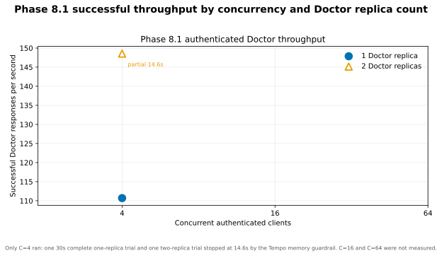
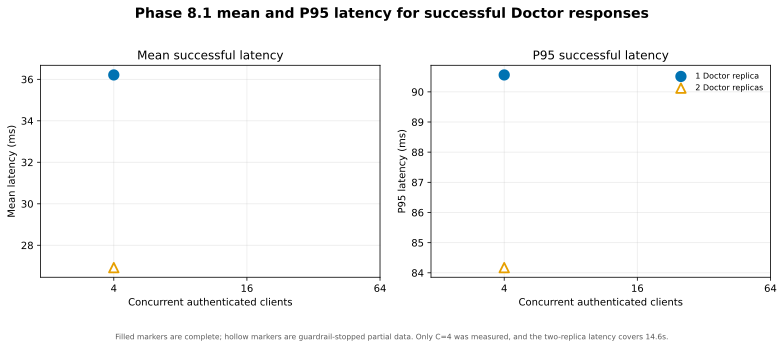
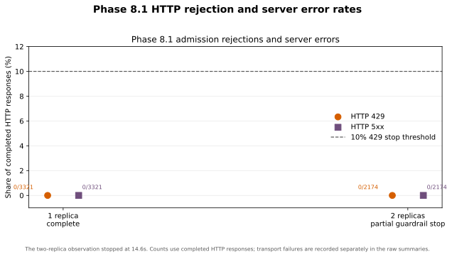
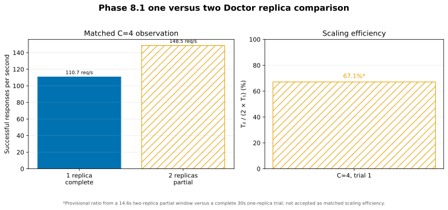

# Phase 8.1 — Performance and Observability Stability Finalization

| Field | Value |
|---|---|
| Date | 2026-10-13 |
| Branch | local `main` |
| Starting commit | `d5d677c8e17fa3a1c71c39a6099ff66f4be2b696` |
| Final verdict | **PARTIAL** |

## 1. Original Phase 8 blockers

The original Phase 8 result remains PARTIAL. Its only authenticated HTTP condition attempted 15,244 requests at four clients and two Doctor upstreams; 15,119 (99.18%) were HTTP 429. That result measured admission rejection throughput, not Doctor request-processing capacity. Tempo reached 99.08% of its 256 MiB memory limit during that trial. A later 120-second idle check recorded one restart, so the Phase 8 load run stopped.

This finalization retained the original measurements and used the fixed Phase 8.1 matrix. It stopped safely during the first two-replica trial when Tempo again approached its memory guardrail. One complete and one partial C=4 sample are available; C=16, C=64 and the remaining trials were not run. No Phase 9 work was started.

## 2. Scope

The work addressed only Tempo stability and authenticated Doctor HTTP performance. It used synthetic identities and read-only GET operations through JWT authentication, Traefik, the Doctor services, PostgreSQL, Redis admission and the existing observability stack. It did not rerun Phase 4 algorithm benchmarks or Phase 6 fault scenarios. No PostgreSQL, Redis, RabbitMQ or Tempo volume was reset or deleted.

## 3. Tempo diagnostic evidence

At the initial inspection, Docker reported `pulsegrid-tempo-1` restarting with restart count 66, exit code 137, `OOMKilled=true`, a 256 MiB memory limit and a 0.25 CPU limit. The prior HTTP trial had sampled 266,023,731 bytes against 268,435,456 bytes (99.08%). This directly establishes an OOM termination under the original per-container cap.

The Docker event query did not return retained lifecycle timestamps for the historical failures. A deliberate container recreation for the configuration change created a new container ID; it did not erase the recorded restart count or the preserved diagnostics. The host snapshot showed a four-CPU Docker VM with 6,198,358,016 bytes (about 5.77 GiB) available, about 1.478 GiB in running containers during the initial inspection, and 44% free macOS memory. The observation setup also recorded Grafana using about 87% of its 256 MiB cap. The initial snapshot did not show Docker-VM-wide memory exhaustion.

Pre-fix container details, host memory output and selected redacted logs are preserved in the [Tempo evidence directory](../experiments/phase8/results/phase8-1-20261013-run1/tempo/).

## 4. Tempo root-cause assessment

| Suspected cause | Evidence and counter-evidence | Assessment |
|---|---|---|
| Tempo memory budget | Docker directly reported OOMKilled and exit 137 at 256 MiB. The original load reached 99.08%. Docker-VM memory was not near its configured ceiling. | High confidence that the 256 MiB cap caused the original termination. The separate matrix restart under 512 MiB has no confirmed cause. |
| Trace volume and sampling | Doctor and Traefik sampling were set to 1.0. Tempo memory peaked at 41.97% during the controlled low-rate observation and at 90.99% during the short two-replica HTTP window. No per-trial spans-ingested series was retained. | Full sampling and higher traffic are plausible contributors to the later memory rise, but the available measurements do not establish causality. |
| Collector batching and queue | The Collector memory limiter is 96 MiB; batches are 256 with a 512 maximum; the exporter queue is bounded at 256 and retry time at 10 seconds. Collector memory stayed below 57% of its cap. No queue-saturation or dropped-span evidence was captured. | No evidence justifies changing batching or queue configuration. |
| WAL and local storage | The old logs contain incomplete-WAL and missing-meta warnings. The ten-minute observation recorded zero missing-meta warnings. A later startup logged `unowned file entry ignored during wal replay` for `blocks`; it did not prove data loss or explain the restart. | Not established as a restart cause. The Tempo volume was preserved. |
| Monolithic mode and worker settings | Tempo 3.1.0 runs in single-binary mode with local WAL and block paths and 24-hour retention. Worker-address auto-configuration warnings appeared. The pinned configuration verified successfully. | The worker warnings match single-binary behavior. They do not identify the restart cause. |
| Idle scheduler messages | The observation recorded 15 `NotFound: no jobs found` scheduler errors and zero other error-level lines. The messages appeared while the scheduler had no work. | Consistent with the documented idle scheduler behavior and [Tempo issue 7403](https://github.com/grafana/tempo/issues/7403); not evidence for the process restart. They remain noisy error-level log entries. |
| CPU or Docker-VM contention | Docker-VM memory peaked at 34.07% during the partial two-replica trial. The measured Docker-VM CPU peak was 239.68% on a four-CPU VM. Grafana used 87.4% of its 256 MiB cap. | No Docker-VM memory exhaustion was measured. The CPU and Grafana caps remain relevant resource limits, but no saturation signal explains the restart. |

Tempo's [deployment-mode guidance](https://grafana.com/docs/tempo/latest/reference-tempo-architecture/deployment-modes/) describes shared resource use in monolithic deployments. Its [local deployment guide](https://grafana.com/docs/tempo/latest/set-up-for-tracing/setup-tempo/deploy/locally/linux/) supports local storage for evaluation. These documented behaviors support using a bounded local configuration, but do not prove the cause of the later restart.

## 5. Tempo configuration change

`compose.observability.yaml` raises only Tempo's memory limit from 256 MiB to 512 MiB. Its 0.25 CPU cap, 100% trace sampling, WAL and local block paths, 24-hour retention, Collector batching, queue and retry limits are unchanged. The finite 512 MiB value was chosen after checking the 16 GiB host, 5.77 GiB Docker VM and observed container pressure. The setting is reversible and does not remove resource limits.

The normal Compose configuration and the pinned Tempo 3.1.0 configuration verification both passed. No Tempo data was deleted. The bounded observation below validates this cap for its controlled low-rate workload only.

## 6. Bounded Tempo stability observation

One ten-minute observation ran with the normal monitoring stack and one authenticated Doctor directory GET every 20 seconds carrying a unique trace context.

| Measure | Observed |
|---|---:|
| Duration | 600.007 seconds |
| Samples / median sample interval | 61 / 9.999 seconds |
| Restart-count delta during observation | 0 |
| Readiness | 61 successes, 0 failures |
| Memory | 91,687,485–225,338,982 bytes; 41.97% peak of 512 MiB |
| CPU | 0.707% mean; 1.64% peak |
| Controlled authenticated requests | 30 HTTP 200, 1 HTTP 401 at token expiry |
| Newly generated trace query | HTTP 200, 13 spans |
| Missing-meta WAL warnings | 0 |
| Idle `no jobs found` scheduler messages | 15 |
| Other error-level log lines | 0 |

The final 401 was caused by the ten-minute access token expiring; the subsequent benchmark runner refreshes its fixture token. All seven API readiness routes were 200 at the observation boundaries. This is a bounded local result, not a production stability guarantee.

The memory/CPU samples, workload, summary and relevant logs are retained under [`tempo/`](../experiments/phase8/results/phase8-1-20261013-run1/tempo/).

## 7. Admission policy and isolation

The benchmark overlay adds a server-side GET-only policy for the exact `phase8-one.localhost` and `phase8-two.localhost` Doctor routes. It uses the existing distributed Redis limiter under a separate Phase 8.1 key namespace. The benchmark principal is taken from the already verified JWT subject and must match the configured synthetic fixture principal. Clients cannot choose their quota identity. The benchmark policy grants no emergency or administrative priority.

The finite authenticated budgets are 10,000 tokens with a 2,000 requests/s refill per principal, and 20,000 tokens with a 2,000 requests/s aggregate refill. Finite pre-auth source and aggregate budgets remain active. The normal Phase 4 quotas and Redis key space are unchanged. The same image, overlay, policy and Redis topology were used for both replica conditions; the runner verified policy imports in both Doctor processes.

The overlay is in [`compose.phase8-benchmark.yaml`](../compose.phase8-benchmark.yaml). Its policy is implemented in the Doctor admission middleware and only applies when the temporary overlay and exact benchmark host are both present.

## 8. Admission preflight and topology verification

The corrected five-second authenticated preflight returned 762/762 HTTP 200 responses: 152.4 attempted, admitted and successful requests/s, zero 429, other 4xx, 5xx, timeouts or connection failures. It exercised the existing directory, autocomplete and profile GET routes. The manifest records that Redis admission was enabled and the normal quota namespace was unchanged.

Before measurement, each routing probe issued 12 authenticated profile GETs; all responses were 200. The one-upstream probe showed requests at the primary Doctor and none at `doctor_replica`; its Redis benchmark-policy counter increased. The two-upstream probe showed traffic at both Doctor processes and an increase in the same Redis-backed policy counter. Both topologies therefore had active upstreams and the admission middleware remained in the path.

An earlier corrected-run attempt is retained under `setup_attempts/`: a stale Doctor image did not allow the temporary host, and its trial was dominated by 429s. That trial was marked invalid, preserved separately and excluded from the matrix below. It is not used as a capacity result.

## 9. Workload and fixed matrix status

The predeclared workload used a deterministic 50% Doctor directory, 30% autocomplete and 20% profile GET mix, a five-second warm-up, a 30-second measurement window, and concurrency 4, 16 and 64. Three trials per replica/concurrency cell were declared before load. This was 18 planned cases; no Phase 4 benchmark, Phase 6 fault scenario, Surge transition or write route was run.

| Case | Planned window | Recorded window | Status |
|---|---:|---:|---|
| `r1-c4-t1` | 30s | 30.000s | Complete; one Doctor upstream |
| `r2-c4-t1` | 30s | 14.635s | Stopped when Tempo reached 90.99% of its memory cap |
| Remaining 16 cases | 30s each | Not started | Stopped safely after the Tempo guardrail |

The run was not resumed after the guardrail. The complete one-replica trial remains valid for that single condition. The stopped two-replica sample is retained as partial evidence and is not treated as a complete matrix cell.

## 10. Throughput, latency and response classification

Each request in both measured windows returned HTTP 200. The raw request row count matches the summary response count; the CSV classification counts also match the JSON summaries. Since these samples contain no rejected or failed responses, successful, admitted and attempted rates and latency distributions are equal within each case.

| Case | Responses | Attempted / admitted / successful RPS | Mean / median / P95 / P99 successful latency | HTTP 429 / other 4xx / 5xx | Timeouts / connection failures |
|---|---:|---:|---:|---:|---:|
| `r1-c4-t1`, 1 replica, complete | 3,321 | 110.70 / 110.70 / 110.70 | 36.21 / 19.51 / 90.56 / 113.45 ms | 0 / 0 / 0 | 0 / 0 |
| `r2-c4-t1`, 2 replicas, partial | 2,174 | 148.55 / 148.55 / 148.55 | 26.92 / 13.21 / 84.17 / 156.56 ms | 0 / 0 / 0 | 0 / 0 |

The two-replica mean and percentiles describe only its 14.635-second guardrail-stopped window. Its observed maximum successful-response latency was 1,126.95 ms. No retries were issued. Both CSVs and summaries are retained in [`results/phase8-1-20261013-run3/`](../experiments/phase8/results/phase8-1-20261013-run3/).

The original 99.18%-429 Phase 8 trial remains in its original result set. The invalid setup trial in the new run is retained beneath `setup_attempts/`; it is not combined with either measured case.

## 11. Resource utilization

Docker stats were sampled approximately every two seconds. These are container-level observations, not host capacity guarantees. Docker CPU percentages are reported as collected and should not be read as a percentage of each container's CPU quota.

| Container / scope | 1 replica: mean / peak CPU; peak memory | 2 replicas, partial: mean / peak CPU; peak memory |
|---|---|---|
| Doctor primary | 49.73% / 52.42%; 95.2 MiB (37.17%) | 46.23% / 52.66%; 91.3 MiB (35.67%) |
| Doctor replica | 3.87% / 17.96%; 92.0 MiB (35.93%) | 45.93% / 52.26%; 95.3 MiB (37.22%) |
| PostgreSQL | 8.31% / 15.10%; 218.0 MiB (42.57%) | 14.04% / 17.15%; 222.8 MiB (43.51%) |
| Redis | 2.94% / 4.08%; 9.3 MiB (7.27%) | 4.54% / 6.29%; 9.3 MiB (7.26%) |
| Traefik | 5.28% / 11.05%; 32.8 MiB (25.62%) | 9.00% / 12.96%; 38.2 MiB (29.83%) |
| Tempo | 3.21% / 26.01%; 245.0 MiB (47.85%) | 12.56% / 26.37%; 465.9 MiB (90.99%) |
| OpenTelemetry Collector | 2.34% / 7.59%; 70.8 MiB (55.30%) | 3.75% / 7.90%; 72.2 MiB (56.41%) |
| Grafana | 0.53% / 1.04%; 223.7 MiB (87.40%) | 3.10% / 20.94%; 223.8 MiB (87.40%) |
| Docker VM memory | 1,809.5 MiB peak (30.61% of 5.77 GiB) | 2,013.9 MiB peak (34.07% of 5.77 GiB) |

Tempo drove the stop. The observed PostgreSQL, Redis and Doctor memory/CPU samples do not show a comparable pressure signal. The short run did not collect database wait-time or pool-saturation series, so it cannot rule out all database constraints. Grafana was already near its own memory cap in both conditions.

## 12. Horizontal scaling comparison

The C=4 rate observed in the partial two-replica window was 1.342 times the complete one-replica rate. Applying the formula mechanically gives a provisional efficiency of 67.09% (`148.55 / (2 × 110.70)`). The two-replica window stopped at 14.635 seconds instead of the planned 30 seconds, so this is not accepted as matched horizontal-scaling efficiency. The formal efficiency result is **not measured**. No C=16 or C=64 comparison exists.

The routing probes showed both Doctor processes received traffic in the two-upstream topology, and the one-upstream probe sent none to the replica. This confirms topology, not equal-duration capacity. No conclusion that a second replica improves performance is supported.

## 13. Graphs and reproducibility

The four Phase 8.1 graphs are generated only from the retained request CSVs, summaries and progress file. Each graph and its PNG counterpart is marked `generated_partial`; the manifest records input paths and SHA-256 hashes. Graph 4 shows the provisional partial-window efficiency with a distinct hatch and states that it is not accepted.

1. Successful throughput by concurrency and replica count:
   
2. Mean and P95 successful-response latency:
   
3. HTTP 429 and 5xx rates:
   
4. One- versus two-replica throughput and provisional scaling efficiency:
   

Regenerate those graphs with:

```sh
python3 experiments/phase8/plot_results.py \
  --run-id phase8-1-20261013-run3 \
  --phase8-1-finalization
```

The [plot manifest](../experiments/phase8/results/phase8-1-20261013-run3/graphs/plot_manifest.json) contains file hashes, data-quality checks, the incomplete matrix and the provisional comparison. The original Phase 8/Phase 4 graphs remain in their historical result directory.

## 14. Tempo and load-test interaction

All benchmark conditions used the same observability configuration, including 100% trace sampling and the same bounded Collector batch/queue settings. The Collector and Docker-VM memory stayed below their observed limits, while Tempo rose from a 245.0 MiB peak in the completed one-replica trial to 465.9 MiB in the short two-replica trial. This temporal association is consistent with increased trace ingestion but does not prove it caused the memory rise. The run did not capture a spans-ingested rate or exporter-queue series that would separate trace volume from Tempo compaction, allocation or another process event.

The guardrail stopped the run at 90.99%. A later read-only container check observed Tempo restart count 2, compared with count 1 before the matrix, and a new process start at `2026-10-13T09:05:46.932Z`. The current inspection reported the process running, exit code 0, and `OOMKilled=false`. No matching retained Docker lifecycle event identified the trigger. The matrix summary taken at the end of the partial sample still showed count 1; therefore the exact restart timing and cause are unresolved. The run did not continue after the memory stop.

## 15. Restoration and safety

The runner restored the original active Traefik route. Its SHA-256 and the mounted Traefik route hash both equal `15e25694927bfc59643d158e49857e2e2a643af65e222a4635c989ac81eae99e`. Both Doctor containers have the benchmark overlay disabled and no benchmark principal configured. The runner waited 12 seconds, longer than the maximum 11-second temporary Redis bucket TTL; it did not delete Redis keys or reset Redis.

The read-only [post-restore recheck](../experiments/phase8/results/phase8-1-20261013-run3/metrics/post-restore-check.json) at 09:09:27 UTC recorded:

- All seven API readiness routes returned HTTP 200 and all Prometheus API and readiness target series were up.
- Authenticated Doctor directory access returned HTTP 200 and the normal Redis-backed admission counter increased by one.
- An unauthenticated Emergency read returned HTTP 401.
- Surge Mode returned `NORMAL`, version 4.
- Tempo was running and its `/ready` endpoint returned ready.
- Both replica services were running; the temporary policy was absent.

The normal and benchmark Compose configurations passed `docker compose config --quiet`. No persistent data volumes were reset or removed. This confirms the experiment's restoration procedures; it is not a full database integrity audit.

## 16. Focused checks

| Check | Result |
|---|---|
| Phase 8 harness unit tests | 7 passed |
| Benchmark helper self-test | 5 passed |
| Doctor benchmark-admission tests | 4 passed; one Starlette/httpx deprecation warning |
| Python compilation for changed Python files | Passed |
| Normal and benchmark Compose configuration | Passed |
| Pinned Tempo configuration verification | Passed |
| Graph regeneration and SVG/PNG manifest hash check | Passed |
| Raw-response count/classification reconciliation | Passed for both recorded trial windows |
| One- and two-upstream routing plus Redis admission checks | Passed |
| Prometheus target/readiness and restoration recheck | Passed |
| Git whitespace check | Passed |

No full backend suite, unrelated benchmark or additional load campaign was run. The plotter used the already installed system Python Matplotlib; no package was installed.

## 17. Acceptance criteria status

| # | Acceptance item | Status and evidence |
|---:|---|---|
| 1 | Authenticated representative Doctor throughput measured | PASS — complete one-replica C=4 case; one additional partial case |
| 2 | New matrix not dominated by 429s | PASS for captured cases — both had zero 429; matrix itself is incomplete |
| 3 | Low, medium and high concurrency available | NOT MET — only C=4 ran |
| 4 | Matched one- versus two-replica measurements | PARTIAL — C=4 trial 1 has one complete and one stopped sample |
| 5 | Successful throughput reported | PASS — 110.70 RPS complete; 148.55 RPS partial |
| 6 | Average and P95 latency reported | PASS — reported separately for the complete and partial sample |
| 7 | HTTP 429 separated from failures | PASS — raw response classes and counts are separate |
| 8 | CPU and memory recorded | PASS — per-container and Docker-VM samples retained |
| 9 | Horizontal scaling efficiency calculated from matched measurements | NOT MET — 67.09% is provisional and rejected as unmatched |
| 10 | Graphs 1–4 reproducible | PASS as partial artifacts — all four graphs and hashes are retained |
| 11 | Tempo restart behavior investigated with direct evidence | PASS — original OOM proven; later restart captured with unknown trigger |
| 12 | Justified Tempo configuration change tested | PASS — 512 MiB cap tested during the bounded observation |
| 13 | Tempo within guardrail during the bounded stability observation | PASS — 41.97% peak during 600.007 seconds |
| 14 | No unexpected restarts during the accepted observation | PARTIAL — zero during ten-minute observation; one additional restart observed after the load stop |
| 15 | Traces remain queryable | PASS — new trace query returned 13 spans |
| 16 | Normal rate limiting restored | PASS — overlay absent, normal Redis policy observed |
| 17 | Surge Mode is NORMAL | PASS — final read returned NORMAL, version 4 |
| 18 | Existing hospital data is intact | PASS for procedure — no volume reset/removal; no full data audit performed |
| 19 | Expected services are healthy | PASS — seven readiness routes and Prometheus API/readiness targets up |
| 20 | Final documentation complete | PASS — this report and the updated Phase 8 report are committed locally |
| 21 | Changes committed locally on main | PASS — four checkpoint commits; no push |

## 18. Final verdict

**PARTIAL.** The corrected admission preflight passed, one complete authenticated C=4 trial was recorded, one two-replica sample was stopped, the raw data and four graphs were preserved, and deployment restoration passed. The run did not complete the fixed 18-case matrix. A temporary increase to Tempo memory would not establish a safe cause or finish the required matched matrix under the existing scope, so the load campaign stopped at the declared guardrail. The later restart trigger remains unresolved. No PASS claim is made.

All work is local to `main`. Nothing was pushed and Phase 9 was not started.
