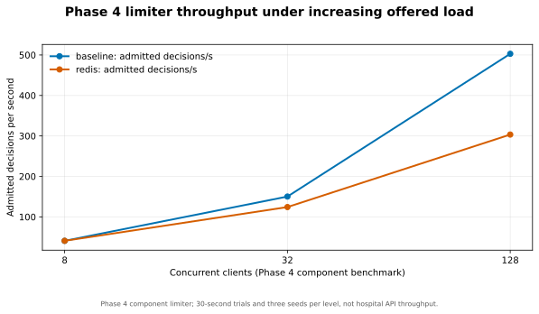
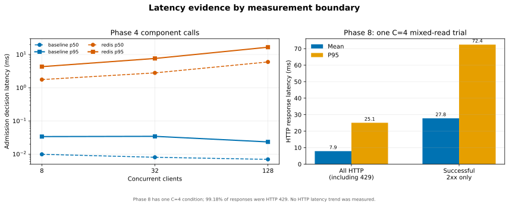
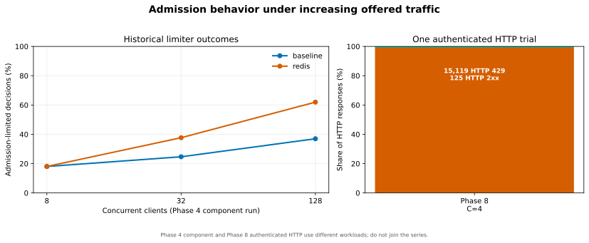
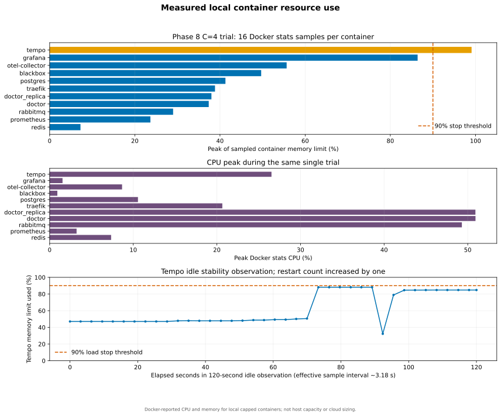
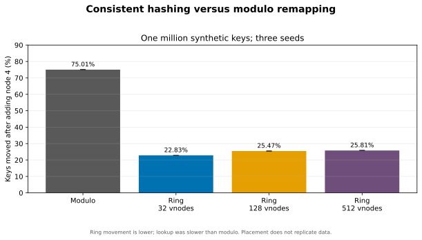
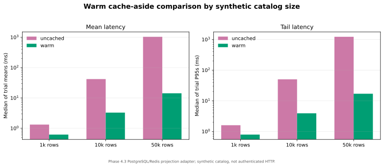
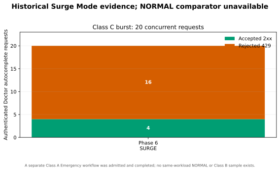
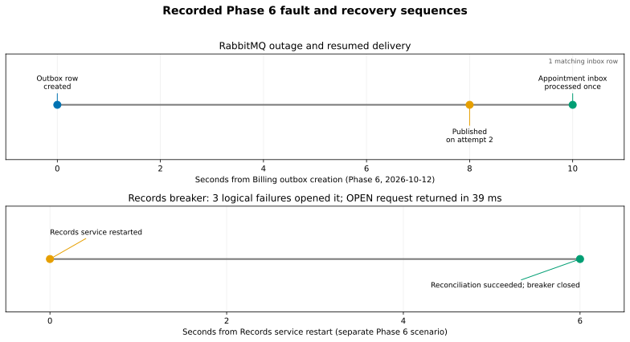

# Phase 8 — Performance, Scalability, and Fault-Tolerance Evaluation

**Evaluation date:** 2026-10-13
**Branch:** local main
**Starting commit:** 1de2a1c
**Verdict: PARTIAL**

## 1. Executive summary

### Phase 8.1 finalization status

Phase 8.1 directly confirmed that the original 256 MiB Tempo cap caused an
OOM termination: Docker recorded exit 137 and `OOMKilled=true`. Tempo now has a
512 MiB cap and retained its 0.25 CPU limit. One ten-minute observation passed
with zero restarts, a 41.97% memory peak, and a newly generated 13-span trace
that remained queryable. During the later HTTP matrix, Tempo reached 90.99% of
that cap and the experiment stopped. A subsequent read-only inspection found
one additional process restart; its trigger remains unresolved.

The corrected admission preflight returned 762/762 successful responses.
One complete authenticated C=4, one-replica trial measured 110.70 successful
responses/s with 36.21 ms mean and 90.56 ms P95 latency. The matched two-
replica trial recorded 148.55 responses/s and 26.92 ms mean / 84.17 ms P95
latency, but stopped at 14.635 seconds of its planned 30 seconds on the Tempo
guardrail. Both captured windows had zero HTTP 429 and 5xx responses. Only one
of 18 planned trials completed; a second is partial, and C=16/C=64 were not
started. Formal scaling efficiency remains unavailable; 67.09% is a
provisional partial-window estimate and is not accepted as a matched result.

The details and measurement boundaries are in the
[Phase 8.1 finalization report](phase-8-1-finalization.md).

The original Phase 8 evaluation below remains historical evidence. It produced
one 30-second authenticated Doctor read-mix trial, a bounded two-upstream
routing probe, and a 120-second idle Tempo observation. That live matrix
stopped when Tempo reached 99.08% of its then 256 MiB container memory limit.

The single HTTP trial completed 15,244 requests: 125 returned 2xx and 15,119 returned expected admission-control 429 responses. It recorded no 5xx responses, timeouts, or connection failures. Since 99.18% of responses were admission rejections, the high attempted request rate is not a measurement of Doctor service capacity.

The existing Phase 4–7 evidence supplies component comparisons, one distributed-quota check, bounded failure and recovery workflows, and a historical Surge Mode check. Neither Phase 8 nor Phase 8.1 completed a low/medium/high HTTP curve or a valid matched one-versus-two-replica capacity comparison. A same-load NORMAL-versus-SURGE comparison and new event-throughput measurements also remain unavailable.

All recorded actors and data were synthetic. The run used authenticated GET requests, preserved the existing data volumes, restored the Traefik route file byte-for-byte, and ended with Surge Mode in NORMAL. This is a local educational prototype evaluation, not a production capacity or clinical reliability certification.

Sections 2–14 retain the original Phase 8 measurements and their scope. The
Phase 8.1 results are additive and do not replace or rewrite the original
429-dominated trial, Phase 4 component experiments, or Phase 6/7 evidence.

## 2. Objectives and scope

The evaluation asked how the retained PulseGrid deployment behaves under bounded Doctor read traffic, how the previously measured algorithms trade performance for their intended properties, and what existing evidence says about admission, Surge Mode, event delivery, selected dependency failures, recovery, resources, and Tempo stability.

The live Phase 8 workload exercised the Traefik-to-Doctor path and its existing PostgreSQL, Redis admission/cache, and observability dependencies. It did not generate sustained load against the other six domain APIs. Appointment booking, patient-journey mutation, clinical writes, dispensing, invoices, payments, and emergency creation were excluded because the retained development databases do not have disposable per-run namespaces and cleanup contracts.

The experiment matrix was fixed before running new measurements in [the Phase 8 plan](phase-8-experiment-plan.md). It was not expanded after the guardrail stop.

## 3. Environment and architecture under test

| Item | Recorded environment |
|---|---|
| Host | Apple Silicon, arm64, macOS 26.6.2, 12 host CPUs, 16 GiB RAM |
| Docker VM | Ubuntu 24.04.2 LTS, 4 CPUs, approximately 5.77 GiB RAM |
| Docker | Engine 28.4.0; Compose 5.0.1 |
| Application topology | Seven FastAPI domain APIs; Doctor and doctor_replica both running; Traefik gateway |
| Data and messaging | PostgreSQL 16.15, Redis 7.4.11, RabbitMQ 4.3.6 |
| Load runner | Python 3.12.11; existing repository virtual environment |
| Container caps relevant to the run | Doctor and replica: 0.5 CPU / 256 MiB each; PostgreSQL: 1 CPU / 512 MiB; Redis: 0.25 CPU / 128 MiB; Traefik: 0.25 CPU / 128 MiB; Tempo: 0.25 CPU / 256 MiB |
| Observability | Prometheus, Grafana, OpenTelemetry Collector, Tempo 3.1.0, and Blackbox exporter |

The Compose project listed 22 containers/services for this topology. Docker reported 31 containers across the daemon, so unrelated local projects could contribute background resource use. The deployment retained the seven independently owned PostgreSQL domains. No service-to-service database access was introduced.

The gateway route was temporarily changed to include the already-running Doctor replica for L1, then restored and hash-checked. This route change did not stop or recreate either Doctor container.

## 4. Workload design and methodology

The locked L1 mix used four closed-loop authenticated clients, two Doctor upstreams, and a 50% directory search / 30% autocomplete / 20% profile GET mix. The fixture seed was 20261013. Preflight returned nine synthetic directory results, ten autocomplete results, and one profile result. A five-second warm-up preceded the 30-second measurement. The existing admission policy remained enabled and unchanged; the cache was warmed by the workload and was not flushed. Requests used a five-second timeout, no retry, and stored no response bodies, identities, credentials, or bearer tokens in the CSV.

The low, medium, and high target levels were 4, 16, and 64 concurrent clients, with three trials planned at each level. Only trial one at concurrency four ran. It used two upstreams and therefore cannot be compared with a one-upstream condition. The plan’s 90% container memory stop threshold was crossed by the sampled Tempo memory peak of 99.08%; the run was recorded as partial and not resumed.

### Matrix status

| Planned work | Result |
|---|---|
| L1 mixed Doctor reads, 4 / 16 / 64 clients, three trials each | PARTIAL: only L1-C4 trial 1 completed (1 of 9); stopped after Tempo memory guardrail |
| S1 one versus two Doctor upstreams, 16 clients, three trials per condition | NOT RUN: no matched comparison; scaling efficiency unavailable |
| S2 same 20-request autocomplete burst in NORMAL and SURGE | NOT RUN in Phase 8; historical Phase 6 SURGE evidence reused |
| T1 idle Tempo stability, 120 seconds | COMPLETED WITH FINDING: readiness stayed available, but Tempo restarted once |
| New Redis, RabbitMQ, Records, or Prometheus fault injections | NOT RUN; bounded Phase 5–7 evidence reused |

### Primary HTTP result

| Case | Requests | Attempted/s | 2xx / admitted/s | 429 | 5xx | Timeout / connection failure |
|---|---:|---:|---:|---:|---:|---:|
| L1-C4-T1, 30 seconds, two Doctor upstreams | 15,244 | 508.13 | 125 / 4.17 | 15,119 (99.18%) | 0 | 0 / 0 |

The 125 successful responses had mean latency 27.766 ms, median 16.179 ms, P95 72.437 ms, and P99 206.557 ms. Across all responses, including the rapid 429 rejections, mean latency was 7.873 ms, median 4.974 ms, P95 25.072 ms, and P99 51.593 ms. The all-response latency distribution is dominated by admission rejections; it is not a successful-operation latency curve. There were no 404 or 409 responses.

Warm-up lasted five seconds and produced 2,266 attempts: 78 successful and 2,188 rate-limited. The measurement itself contains 15,244 request samples in [the raw request CSV](../experiments/phase8/results/phase8-20261013-run1/requests/l1-c4-t1.csv), with classifications and percentiles in [the case summary](../experiments/phase8/results/phase8-20261013-run1/summaries/l1-c4-t1.json).

The graphs intentionally do not draw a Phase 8 concurrency trend: only one HTTP concurrency point was measured. Graph 1 is the Phase 4 rate-limiter component benchmark, not whole-service request throughput.

## 5. CPU and memory observations

Sixteen Docker stats samples were recorded for the 30-second L1 case. The following values are sampled maxima, not long-run capacity estimates. Docker CPU percentages are reported as collected; they are not directly comparable to percentages of a service quota.

| Container | Peak CPU (%) | Peak memory (%) |
|---|---:|---:|
| Doctor API | 50.93 | 37.36 |
| Doctor replica | 50.92 | 37.99 |
| PostgreSQL | 10.56 | 41.28 |
| Redis admission | 7.35 | 7.24 |
| Traefik | 20.65 | 38.83 |
| RabbitMQ | 49.30 | 28.99 |
| Tempo | 26.53 | **99.08** |
| Grafana | 1.54 | 86.41 |
| OpenTelemetry Collector | 8.66 | 55.65 |
| Prometheus | 3.22 | 23.66 |

The captured resource samples are in [resources/l1-c4-t1.csv](../experiments/phase8/results/phase8-20261013-run1/resources/l1-c4-t1.csv). The peak occurred in Tempo at 266,023,731 bytes against its 268,435,456-byte limit. It triggered the experiment stop. The Doctor containers and PostgreSQL did not show a resource peak comparable to that stop condition in this one sample.

## 6. Horizontal scalability

The Compose deployment already had two Doctor containers. A bounded 12-request profile probe through the temporary two-upstream route observed traffic at both Doctor containers, and all probe responses were 200. This only verifies routing to both upstreams. It does not compare equal-duration one- and two-upstream loads.

The planned S1 workload did not run. There is no matched throughput, latency, error-rate, or per-replica utilization pair; horizontal scaling efficiency is therefore **not measured**. No claim that a second replica improves capacity or latency is supported by this evaluation. The probe evidence is retained in [topology_probe.json](../experiments/phase8/results/phase8-20261013-run1/summaries/topology_probe.json).

## 7. Reused Phase 4 performance comparisons

All results in this section are historical Phase 4 measurements. Component and adapter runs are labeled separately from authenticated endpoint observations. Source details and the original conditions are in the [Phase 4 verification report](phase-4-integration-verification.md), the component result directories, and their manifests.

### Distributed rate limiting

The three-trial component benchmark used 30-second runs, seeds 404–406, and 8 / 32 / 128 clients at 50 / 200 / 800 target decisions/s. The table shows the median trial values. Redis coordination preserves a shared quota across processes but adds decision latency and limits admissions to the global budget.

| Clients | Baseline admitted/s | Redis admitted/s | Baseline reject (%) | Redis reject (%) | Baseline P95 (ms) | Redis P95 (ms) |
|---:|---:|---:|---:|---:|---:|---:|
| 8 | 40.87 | 40.87 | 18.05 | 18.05 | 0.0338 | 4.3069 |
| 32 | 150.23 | 124.27 | 24.68 | 37.70 | 0.0343 | 7.5921 |
| 128 | 502.87 | 303.37 | 36.97 | 61.98 | 0.0233 | 16.5797 |

This is a limiter decision benchmark, not an API throughput benchmark. In a separate authenticated Traefik check, 100 Doctor searches yielded 63 accepted responses and 37 expected 429s, with no transport or server errors. Per-replica counters agreed with the response counts. A matched limiter burst admitted 120 of 160 under the local-only baseline and 60 of 160 under the Redis shared quota. These results demonstrate quota coordination and its latency cost, not a blanket performance win. The raw trial summaries are [low](../experiments/phase4/rate_limiter/results/redis7-low/summary.csv), [medium](../experiments/phase4/rate_limiter/results/redis7-medium/summary.csv), and [high](../experiments/phase4/rate_limiter/results/redis7-high/summary.csv).

### Cache-aside

The indexed PostgreSQL/Redis adapter benchmark used three trials at each catalog size. The table reports the audited means of per-trial mean and P95 latencies.

| Synthetic rows | Uncached mean / P95 (ms) | Warm cache mean / P95 (ms) | Warm hit ratio |
|---:|---:|---:|---:|
| 1,000 | 1.397 / 1.761 | 0.686 / 1.010 | 0.9998 |
| 10,000 | 4.484 / 6.444 | 3.053 / 3.803 | 0.9998 |
| 50,000 | 25.565 / 36.418 | 12.619 / 15.836 | 0.9995 |

The warm adapter improved the measured result at all three catalog sizes. The separate authenticated five-Doctor endpoint result went the other way: across three paced 30-second one-client trials, uncached mean/P95 was 11.18/20.57 ms, cold cache was 23.49/61.82 ms, and warm cache was 23.44/44.37 ms. That small live endpoint did not benefit from caching. These layers must not be combined into one cache speedup claim. Adapter CSVs are [low](../experiments/phase4/key_value_cache/results/low-final/summary.csv), [medium](../experiments/phase4/key_value_cache/results/medium-final/summary.csv), and [high](../experiments/phase4/key_value_cache/results/high-final/summary.csv).

### Consistent hashing

The CPU-only placement benchmark used one million synthetic keys, seeds 404–406, and three trials, moving from three to four nodes.

| Placement | Virtual nodes | Keys remapped | One-reader throughput | One-reader P95 |
|---|---:|---:|---:|---:|
| Modulo | 0 | 74.971–75.118% | 1.164–1.186 million lookups/s | 792–833 ns |
| Ring | 32 | 22.821–22.831% | 1.021–1.028 million lookups/s | 958 ns |
| Ring | 128 | 25.426–25.502% | 0.971–0.984 million lookups/s | 1,000 ns |
| Ring | 512 | 25.773–25.893% | 0.897–0.942 million lookups/s | 1,041–1,167 ns |

Ring/32 minimized movement among the tested ring sizes and was slower than modulo in the measured lookup. A separate real cache-topology check placed 10,000 keys 5,341/4,659 across two nodes; adding a third moved 28.56% with the ring versus 67.31% with modulo. Consistent hashing reduces remapping during topology changes; it does not replicate cache data or provide high availability. These are placement and adapter results, not Doctor API throughput. See the [one-million-key report](../experiments/phase4/consistent_hashing/results/high-404/report.md) and [movement samples](../experiments/phase4/consistent_hashing/results/high-404/movement.csv).

### Unique ID generation

The Phase 4 loopback PostgreSQL pipeline benchmark measured 4.5 million Snowflake allocations and inserts over low, medium, and high client levels, with zero observed collisions in those trials. CSPRNG had higher mean throughput than the Snowflake pipeline by 2.136× at low, 1.806× at medium, and 2.368× at high. The Snowflake pipeline throughput ranges were 2,806–5,587 IDs/s low, 10,449–10,849 medium, and 5,485–10,793 high. Its selection provides additive distributed-ID properties in this design; the measurements do not show it as the faster generator. This was not a hospital endpoint benchmark and zero observed collisions is not a global uniqueness proof. The [combined report](../experiments/phase4/unique_id/results/combined/report.md) and [summary CSV](../experiments/phase4/unique_id/results/combined/summary.csv) preserve trial details.

### Short links

Phase 4.5 compared a direct workflow GET with alias resolution and creation in a local PostgreSQL adapter workflow. At high load (32 clients), direct workflow P95 was 33.01–35.71 ms across three trials. Alias-resolution P95 ranged from 119.63 ms in two trials to 1,989.01 ms in one; the three trials recorded 143–192 operation errors. A separate diagnostic classified 488 exceptions as timeouts, consistent with pool pressure, though the exact timeout source was not confirmed. The actual authenticated gateway matrix remained partial, so these adapter measurements are not a high-concurrency gateway result. See the [Phase 4.5 report](../experiments/phase4/short_links/results/seed-404/report.md).

### Synthetic insurance crawler

The crawler used loopback synthetic provider pages and an in-memory persistence fake. At the high dataset and 20 ms provider delay, measured throughput was 18.539 ± 0.149 pages/s sequentially, 51.548 ± 0.641 with four global slots, and 52.376 ± 0.109 with eight slots. The small gain from four to eight slots suggests the tested crawler workload was near its own limit at four slots. It does not measure Billing, PostgreSQL, or insurer capacity. The [crawler report](../experiments/phase4/insurance_crawler/results/phase4-insurance-20261012/report.md) contains seed-level results and the fake-persistence boundary.

### Autocomplete

The 100,000-entry CPU-only Doctor and Pharmacy trie cases were compared with a sorted-prefix baseline. Across repeated runs the trie was not consistently faster. Estimated trie memory was 123.03 MiB for Doctor and 114.51 MiB for Pharmacy, both above the configured 64 MiB production cap, so the live implementation falls back to its owner database at that size. These results do not establish large-catalog authenticated route latency. The [high-catalog report](../experiments/phase4/autocomplete/results/2026-10-12-high-seed404/report.md) contains its trial data and memory notes.

## 8. Surge Mode

Phase 6 recorded one bounded 20-request authenticated Doctor autocomplete burst in SURGE. Four Class C requests returned 2xx and sixteen returned 429; every observed Retry-After was at least one second. In a separate time window, a synthetic Class A Emergency request was admitted and staff completed its authorized priority, claim, and resolution workflow.

There was no same-workload NORMAL sample and no Class B load sample. The Class A workflow was not measured in the same window as the Class C burst, so it does not quantify a shared-capacity guarantee. This is useful bounded evidence that the existing policy rejected most deferrable requests while a separate critical workflow succeeded, but it is not a controlled NORMAL-versus-SURGE comparison. The Phase 8 S2 comparison did not run. The Phase 6 values are a report transcription because request-level raw samples are not retained; see [historical_phase6.json](../experiments/phase8/results/phase8-20261013-run1/summaries/historical_phase6.json) and [the Phase 6 verification report](phase-6-integration-verification.md).

## 9. RabbitMQ delivery and fault-recovery evidence

Phase 5 verified both Pharmacy-to-Appointment and Billing-to-Appointment event paths during ten synthetic gateway workflow groups. Selected events were observed in producer outboxes and once in the corresponding Appointment inbox subscriptions. This was workflow correctness evidence, not a throughput test.

Phase 6 exercised a Billing-to-Appointment RabbitMQ outage. A valid synthetic Billing payment committed while the broker was unavailable and its outbox event remained unpublished. The recorded timeline was:

| Event | UTC time on 2026-10-12 |
|---|---:|
| Billing outbox row created | 19:47:59 |
| Event published on attempt 2 | 19:48:07 |
| Appointment inbox processed event | 19:48:09 |

The observed intervals were eight seconds from outbox creation to publication and two seconds from publication to inbox processing. The post-recovery owner-database check found one matching inbox row. This supports outbox retention and consumer recovery for this selected case. The outage start timestamp, queue-depth series, pending-outbox age distribution, general event throughput, and duplicate-processing rate under sustained delivery were not measured.

The Phase 6 Records failure case counted three logical failures before opening the Appointment breaker. An open-breaker request returned in 39 ms. After restarting only the Records API container, reconciliation succeeded about six seconds later; the breaker closed and the patient journey returned to ready with no source error. Phase 6 Redis outage checks observed a mix of authenticated 200 and 429 responses from conservative local admission fallback, but did not retain per-status counts or recovery timing. Phase 7 documented that Prometheus downtime did not interrupt business operations. Those were bounded historical checks; Phase 8 did not repeat dependency failures against the retained persistent volumes. See the [Phase 5](phase-5-integration-verification.md), [Phase 6](phase-6-integration-verification.md), and [Phase 7](phase-7-integration-verification.md) verification reports.

## 10. Tempo stability investigation

Phase 7 had documented 13 Tempo restarts, no OOM kill, an incomplete WAL block missing meta.json, and successful readiness and trace querying after restart. No Tempo data volume was removed or reset during Phase 8.

The Phase 8 idle observation requested 120 seconds without generated load. It sampled readiness 39 times and all 39 probes succeeded. The median actual interval was 3.18 seconds because Docker command overhead exceeded the nominal two-second cadence. Tempo restart count increased from 22 to 23; the sampled started-at value changed at about 92 seconds into the observation. Exit code was zero and OOMKilled was false. Memory ranged from 86,633,349 to 236,663,603 bytes, peaking at 88.16% of the 256 MiB cap.

The same trace search at the start and end each inspected 648 traces and returned one trace. Matching counts do not prove that the returned trace was identical. The bounded log window contained seven warning lines and three error lines: three “no jobs found” scheduler warnings; three corresponding worker errors; one unowned WAL entry warning; one metrics-generator-not-configured warning; and two single-binary worker/scheduler auto-configuration warnings. No missing-meta replay warning appeared in that 120-second log window. Docker returned no lifecycle event rows even though sampled restart_count and started_at showed a restart.

A separate read-only finalization snapshot at 07:35:53 UTC found Tempo still running, with readiness returning “ready,” exit code 0, and OOMKilled=false. Restart count had risen to 27, four above the T1 end count of 23; its current started-at time was 07:34:37 UTC. Logs collected after the T1 window contained three failed WAL replays with missing meta.json, four unowned WAL entry warnings, 54 scheduler “no jobs found” lines, and eight single-binary auto-configuration warnings. These later lines are outside the T1 7-warning / 3-error counts and are retained separately in [the finalization snapshot](../experiments/phase8/results/phase8-20261013-run1/tempo/finalization_snapshot.json), [the post-T1 log summary](../experiments/phase8/results/phase8-20261013-run1/tempo/post_t1_log_summary.json), and [the redacted relevant log lines](../experiments/phase8/results/phase8-20261013-run1/tempo/post_t1_relevant_logs.txt). The readiness probe is a single point-in-time check, not a stability window.

The version-matched Tempo 3.1.0 source automatically configures the worker and scheduler addresses when the single-binary deployment leaves them blank, so those two startup warnings are expected for that mode. That code does not explain the “no jobs found” messages or the observed process restart. Grafana documents that monolithic components share a resource pool and can experience memory pressure. At the time, the evidence did not identify the restart trigger. Phase 8.1 later confirmed the original 256 MiB OOM and raised the cap to 512 MiB; its separate ten-minute observation had no restarts, but a later partial HTTP trial again approached the cap and a subsequent inspection found one additional restart with its trigger unresolved. See the [Phase 8.1 finalization report](phase-8-1-finalization.md) for the later measurements. [Tempo v3.1.0 modules.go](https://github.com/grafana/tempo/blob/v3.1.0/cmd/tempo/app/modules.go), [Grafana Tempo deployment modes](https://grafana.com/docs/tempo/latest/reference-tempo-architecture/deployment-modes/).

Raw samples, the summary, and bounded relevant log lines are preserved in the [Tempo evidence directory](../experiments/phase8/results/phase8-20261013-run1/tempo/).

## 11. Observability validation

Phase 7 verified Prometheus scraping for eight API targets (seven domains plus the second Doctor process), application request metrics, RabbitMQ queue series, Surge Mode counters, selected traces, Control Room availability, and the dashboard query expressions. Its report records successful execution of 30 dashboard PromQL expressions; see [Phase 7 verification](phase-7-integration-verification.md).

Prometheus does not have PostgreSQL, Redis, or container exporters in this stack. The original Phase 8 CPU and memory figures therefore come from Docker stats sampling, while API, admission, cache, and RabbitMQ observations in historical reports come from Prometheus or owner checks as identified in their source reports. The Phase 8.1 per-request HTTP data comes directly from the benchmark runner. Its one- and two-upstream probes confirmed the configured routes and Redis admission; no complete per-trial Prometheus delta was collected for the guardrail-stopped partial trial.

## 12. Bottleneck and trade-off analysis

In the original Phase 8 run, the stop condition was Tempo memory pressure against a 256 MiB cap; it reached 99.08% without an OOM kill in that particular sample. The original 120-second idle check later recorded a restart. Phase 8.1 increased the bounded cap to 512 MiB and passed a ten-minute low-rate observation at 41.97% peak memory. During the subsequent two-replica C=4 trial, Tempo reached 90.99% and the run stopped; a follow-up inspection recorded one additional restart with `OOMKilled=false` at inspection time. The exact trigger remains unresolved.

The original HTTP result is chiefly an admission-control observation: nearly every request was rejected quickly. Its 508.13 attempted requests/s and low all-response P95 do not demonstrate Doctor throughput or saturation. Phase 8.1 produced one complete one-replica C=4 trial at 110.70 successful responses/s and one guardrail-stopped two-replica sample at 148.55 responses/s. Both captured new windows had zero 429 and 5xx responses, but only one was complete; neither establishes a concurrency trend or accepted matched scaling efficiency.

The Phase 4 component measurements expose a coordination trade-off: Redis-backed global admission adds several milliseconds of decision latency and admits fewer requests than process-local buckets under higher offered load, while enforcing the intended shared quota. Warm cache benefits depend on catalog size and access layer; the small authenticated endpoint regressed. Consistent hashing moves fewer keys during node addition at a measurable lookup cost and does not itself replicate them. CSPRNG beat the Snowflake insertion pipeline on throughput, while Snowflake serves a different ID-allocation property. Trie autocomplete sometimes wins and sometimes loses against sorted prefixes, with the high-catalog memory cost exceeding its configured cap. Bounded crawler concurrency improved throughput up to four slots in the measured high fixture, with little added gain at eight.

No database saturation, Redis saturation, or gateway capacity limit can be identified from the stopped HTTP trial. There were no database wait or connection-pool measurements for it. The report therefore treats Tempo memory and admission policy as observed constraints and leaves application capacity bottlenecks unproven.

## 13. Security, data integrity, and deployment recovery

The new HTTP workload used authenticated synthetic patient access to read-only routes. No credentials, access tokens, response bodies, patient IDs, or Doctor IDs were stored in the request CSV. No state-changing hospital endpoint was used during L1. No database, Redis, RabbitMQ, or Tempo volume was reset.

The original Phase 8 run manifest records Surge Mode NORMAL, version 4, and the historical route hash `0c93b76e…`. Phase 8.1 separately restored the active Phase 4 route to `15e25694927bfc59643d158e49857e2e2a643af65e222a4635c989ac81eae99e`; a post-run read-only check found the mounted Traefik hash matched the source. Both Doctor containers had the temporary policy disabled, authenticated Doctor directory access used normal Redis-backed admission, and an unauthenticated Emergency read returned 401. All seven API readiness routes and Prometheus API/readiness targets were up; Surge Mode was NORMAL, version 4. The separate Tempo readiness probe returned ready. See the [Phase 8.1 restoration evidence](../experiments/phase8/results/phase8-1-20261013-run3/metrics/post-restore-check.json).

This evaluation does not establish clinical validity, emergency dispatch reliability, high availability, or production security certification.

## 14. Graphs and evidence map

The plotting script regenerates the retained graphs from Phase 4 CSV/JSON and Phase 8 CSV/JSON. The plot manifest identifies the source files and scope for each figure.

| Figure | Evidence and meaning |
|---|---|
| 1 | Phase 4 rate-limiter component throughput by client level |
| 2 | Phase 4 component latency plus one distinct Phase 8 HTTP latency observation |
| 3 | Phase 4 limiter outcomes plus one Phase 8 HTTP outcome |
| 4 | Not generated: no matched one/two-upstream scaling comparison |
| 5 | Phase 4 warm versus uncached cache adapter latency |
| 6 | Phase 4 one-million-key remapping results |
| 7 | Historical SURGE admission only; NORMAL and Class B comparisons are missing |
| 8 | Historical Phase 6 Records and RabbitMQ recovery timelines |
| 9 | One Phase 8 load trial and the idle Tempo observation |

The generated SVG and PNG files and their declared scopes are under [the result graphs directory](../experiments/phase8/results/phase8-20261013-run1/graphs/). Graph 4 is intentionally absent rather than interpolated from unrelated results.

Phase 8.1 adds a separate set of four graphs under
[`phase8-1-20261013-run3/graphs/`](../experiments/phase8/results/phase8-1-20261013-run3/graphs/).
They are generated from the new CSV/JSON evidence and labeled partial. Graph 4
shows a hatched provisional efficiency from the stopped 14.635-second
two-replica window; the formal matched scaling efficiency remains unavailable.

## 15. Limitations and incomplete acceptance criteria

- The original Phase 8 HTTP matrix contains one 99.18%-429 trial. Phase 8.1 has one complete C=4 one-replica trial and one partial C=4 two-replica sample; neither supplies the 4 / 16 / 64 multi-trial curve.
- The provisional 67.09% scaling efficiency uses unequal completed windows and is not accepted as a matched result.
- Phase 8 did not execute its same-workload NORMAL/SURGE pair or measure Class B admission.
- No Phase 8 event throughput, queue depth, pending outbox age, or sustained duplicate-delivery experiment was run.
- Redis, RabbitMQ, Records, and Prometheus outage evidence is reused from Phase 5–7 bounded checks and lacks some raw request counts or timing detail.
- Phase 4 components used different hardware caps, databases, catalog sizes, and workload layers. They are historical comparisons, not direct Phase 8 capacity baselines.
- The local MacBook and Docker resource caps do not represent a cloud or production deployment.
- Docker reported other local containers outside the Compose project, and no full-host isolation was established.
- Tempo had zero restarts during the 600-second Phase 8.1 stability observation, then one additional process restart was observed after the later load stop. Its exact trigger remains unresolved.
- No final PDF was created; that deliverable belongs to Phase 9.

These gaps make the evaluation **PARTIAL**, not a system correctness failure.

## 16. Reproduction instructions and checks

From the repository root, the original Phase 8/Phase 4 charts can be regenerated without running live services:

    python3 experiments/phase8/plot_results.py

Regenerate only the Phase 8.1 Graphs 1–4 from the retained run with:

    python3 experiments/phase8/plot_results.py --run-id phase8-1-20261013-run3 --phase8-1-finalization

The harness checks can be run without contacting the stack:

    ./.venv/bin/python -m unittest discover -s experiments/phase8 -p 'test_*.py' -v
    ./.venv/bin/python experiments/phase8/benchmark.py --self-test
    python3 -m py_compile experiments/phase8/observe_tempo.py experiments/phase8/plot_results.py

A fresh live matrix requires a healthy local Compose deployment and the private synthetic fixtures described in [the Phase 8 README](../experiments/phase8/README.md). Use a new run ID for any future authorized campaign; the retained run ID is guardrail-stopped and the runner refuses to resume it. The original fixed matrix command is documented in that README. The Tempo observation command is also documented there; do not treat the retained trace query count as proof of trace identity.

Phase 8.1 focused checks completed:

- Phase 8 harness unit tests: 7 passed; benchmark helper self-test: 5 passed.
- Doctor benchmark-admission tests: 4 passed (one deprecation warning).
- Python compilation, normal and benchmark Compose configuration, and pinned
  Tempo configuration verification: passed.
- Four Phase 8.1 graphs regenerated from raw CSV/JSON; manifest sample counts
  and SVG/PNG hashes verified.
- One/two-upstream routing, normal Redis admission restoration, API readiness,
  Prometheus targets, Emergency authentication, and Surge Mode NORMAL checked.
- `git diff --check` passed. Final branch is local `main`; the worktree is
  clean. No push, full backend regression suite, new matrix, or package
  installation was performed; no persistent volume was reset.

## 17. Final verdict

**PARTIAL.** Phase 8 preserves the original admission-dominated HTTP trial and historical component/fault evidence. Phase 8.1 adds a corrected Redis-backed admission preflight, one complete authenticated C=4 trial, one guardrail-stopped two-replica sample, per-container resource samples, a bounded Tempo observation and four reproducible partial graphs. The fixed matrix did not complete; low/medium/high scaling and a valid matched efficiency remain unavailable. Tempo stayed within its guardrail during the ten-minute observation, but approached the limit during the HTTP run and had one later restart with an unresolved trigger.

The final state was restored to the normal deployment route and admission policy; all API readiness and Prometheus targets were up, Emergency authentication remained enforced, and Surge Mode was NORMAL. All changes are committed locally on `main`; nothing was pushed, and Phase 9 was not started.
